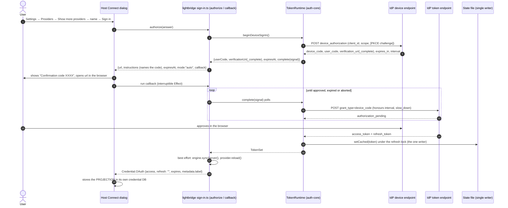
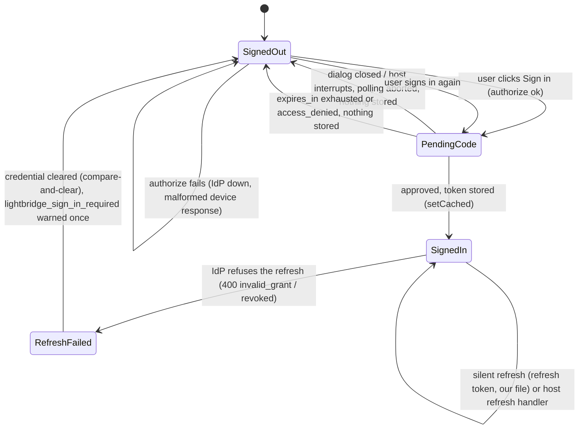

# ADR-0023 — sign in through the host's Connect dialog: an `oauth` Integration method that projects a marker, never the refresh token

- **Status:** Accepted. **Supersedes [ADR-0020](0020-oauth2-integration-domain.md) and
  [ADR-0021](0021-needs-auth-via-connection-status.md)** for `@vymalo/opencode-lightbridge`. The
  oauth2 plugin is not ported by this change and keeps its ADR-0020 behaviour until it is.
- **Date:** 2026-11-10
- **Applies to:** `@vymalo/opencode-lightbridge`, `@vymalo/opencode-auth-core`,
  `@vymalo/opencode-provider-sync`. Follows [ADR-0019](0019-opencode-v2-cutover.md) (v2 only) and
  [ADR-0022](0022-credentials-in-state-dir.md) (credentials have one writer, in the state dir).

## Context

Until now lightbridge signed the user in with an OAuth device-code flow whose prompt went to
**stderr** and to the log. The v2 host runs the plugin server with stderr closed, so the code was
never seen: users sat at a provider with no models and no hint (ADR-0020 accepted that as a cost;
ADR-0021 tried to soften it with a sticky `connection.status` notice). Both left the *act* of
signing in where nobody could find it — on the first chat request, inside a hook.

We then verified on a real host (OpenCode 2.2.5, from its bundled source) that a plugin can register
an **`oauth` Integration method**. The host renders a native *Connect* dialog ("Your browser opens so
you can sign in… Waiting for authorization… [Open browser] Confirmation code XXXX"), opens the
`url` we return, and awaits our `callback`. That is exactly the surface the device flow was missing.

Facts about the host that shape the decision (all read from the host, not assumed):

1. `ctx.integration.transform((editor) => …)` creates an integration on first `update`, and a
   plugin-created integration appears as its own service in the host's Integrations dialog.
2. `IntegrationOAuthMethodRegistration` is `{ integrationID, method, authorize, refresh?, label? }`;
   `authorize` returns `{ url, instructions, expiresAt, mode: "auto", callback }` and the host runs
   `callback` as an Effect it can interrupt.
3. The host persists whatever `Credential.OAuth` the callback returns
   (`{ type, methodID, refresh, access, expires, metadata? }`) in **its own** credential database.
4. If the user closes the dialog, or the attempt expires, the host closes the attempt's scope — the
   callback must therefore be interruptible, and must stop polling when it is.
5. `connection.resolve` calls our `refresh` only within 5 minutes of `expires`; with none it returns
   the stored value as-is.
6. The host loads the **well-known** manifest (`https://ai.camer.digital/opencode`) using
   `credentials.at(-1)` of *that* integration, and only when it is `type: "key"`.
7. A provider declared by the well-known manifest is forced `activation: "enabled"` and the host does
   **not** use our integration's credential to authenticate its requests.

## Decision

**Sign-in is an `oauth` method on a new integration, and it is the *only* thing in lightbridge that
may start an interactive login.**

### Rules

1. **Custody (load-bearing): the refresh token never leaves our state file.** The `Credential.OAuth`
   we return has `refresh: ""` always, and carries only the current access token plus a display
   label. The host's copy is a **projection and a "connected" marker, not the credential of record**
   (fact 7: the host does not authenticate requests with it). Lightbridge keeps injecting the bearer
   itself, exactly as before (`gateway` / `register`). This is what answers the objection that ADR-0020
   and ADR-0021 both raised against an `oauth` method — *dual custody of a rotating refresh token* —
   there is no second copy to rotate.
2. **Our `refresh` handler ignores the host's credential.** It returns the same projection from the
   runtime's current token via a **non-interactive** ensure. If the root was revoked or cleared it
   *fails the Effect*; it never starts a flow.
3. **Register on `auth.id`, never on the well-known integration** (fact 6). An `oauth` credential on
   the well-known integration would be `credentials.at(-1)` and, not being `type: "key"`, would make
   the host stop loading the manifest and freeze it to its cache. A new integration named after
   `auth.id` (display name `register.name`, else `auth.id`) is its own service in the Integrations
   dialog and cannot touch the manifest.
4. **The single writer stays single.** `TokenRuntime.beginDeviceSignIn().complete()` polls and then
   stores through the existing `persist` → `setCached`, under the cross-process refresh lock
   ([ADR-0022](0022-credentials-in-state-dir.md)). An abort checked inside the lock means a late
   cancellation stores nothing.
5. **Hard cutover: nothing else starts an interactive flow.** `LightbridgeRuntime.getProjectToken`
   lost its `interactive` option and is always refresh-only; the register module's
   `ProviderModelSyncEngine` is built with `neverInteractive: true` (warmup, scheduler,
   `syncServer`, `ensureAccessToken`); the OTEL `TokenSource` was already non-interactive. When no
   usable token exists the plugin logs **one** `warn`, `lightbridge_sign_in_required`, naming
   *Settings → Providers → Show more providers → \<name\> → Sign in*. There is no flag to turn the
   old behaviour back on.
6. **Abort is real.** The callback is `Effect.tryPromise((signal) => complete(signal))`; the host
   closing the attempt interrupts the fiber, which aborts `signal`, which stops the sleep, the
   in-flight token request and the loop, and stores nothing.

### Discoverability and the browser

The host opens `url` itself when the user clicks *Sign in* (it prefers `verification_uri_complete`,
so the code is pre-filled; the dialog still shows the code for the case where it is not). The path
to the button is *Settings → Providers → Show more providers → search for the integration name*.
That path is the string in the `lightbridge_sign_in_required` warning, so the log line is a complete
instruction, unlike the stderr prompt it replaces.

### Side change: the stderr prompt can no longer raise EPIPE

oauth2 still uses the stderr device prompt (ADR-0014's carve-out). Under a v2 host stderr is a
closed pipe and a bare write emitted an `EPIPE` the host reported as `ERROR "unhandled rejection"`.
`writeTerminalPrompt` (auth-core) attaches a short-lived `error` listener for the write — Node reports
a failed write through the callback *and then* as an `error` event on a later tick, so the listener
outlives the callback — and logs the skip once at `debug`.

## Consequences

- The user sees a code, in the host, at the moment they ask for it. "Nothing happens" is no longer a
  failure mode of signing in.
- The host holds a marker credential that expires hourly and is refreshed by our handler. A host
  credential-store leak yields an access token, never the refresh token.
- A user of `authFlow: "authorization_code"` has **no** sign-in surface in lightbridge any more (the
  Connect dialog is a device-code surface; a loopback browser flow is not driven from it). The plugin
  warns `lightbridge_sign_in_unsupported_flow`. Machine flows (`client_credentials`, `jwt_bearer`,
  `token_exchange`) are non-interactive by nature and are unaffected.
- `ProviderModelSyncEngineOptions.neverInteractive` and `TokenRuntime.beginDeviceSignIn` are new
  public surface. oauth2's behaviour (stderr prompt, TTY-aware warmup) is unchanged and is the
  follow-up to port.
- `ADR-0021`'s `connection.status` channel is not used; there is no `needs_auth` notifier, no
  integration index and no sign-in notifier to maintain.

## Open questions

- Whether a host that someday *does* use the integration's credential to authenticate provider
  requests would then send our access token (it would still work) or try to refresh it (our handler
  answers). Both are safe by the custody rule; neither is exercised today (fact 7).
- Whether the host clears a stale `needs_auth` it did not set; moot until something sets one.

## Alternatives considered

**Keep the stderr/log prompt (ADR-0020).** Rejected: measured to be invisible under the v2 host.

**`connection.status` `needs_auth` notice (ADR-0021).** Rejected here: it tells the user to sign in
but still gives them nowhere to do it, and needs a connection to hang on — which a manifest-declared
provider does not have. Superseded by a surface that is both the notice's destination and the action.

**Store the real refresh token in the host credential and let the host refresh.** Rejected: dual
custody of a single-use rotating token. Two writers replaying one chain is exactly the reuse-detection
revocation fixed in 0.19.0 ([ADR-0022](0022-credentials-in-state-dir.md)).

**Register the method on the well-known integration.** Rejected: freezes the manifest (fact 6).

**An `external` or `command` method / a `bin` login CLI.** Rejected / deferred: they move the flow
outside the host dialog or outside the plugin; the native dialog already exists and is where users look.

**A feature flag keeping the old interactive path.** Rejected by policy — a dormant second path is a
second way to start a flow that nobody can see.
