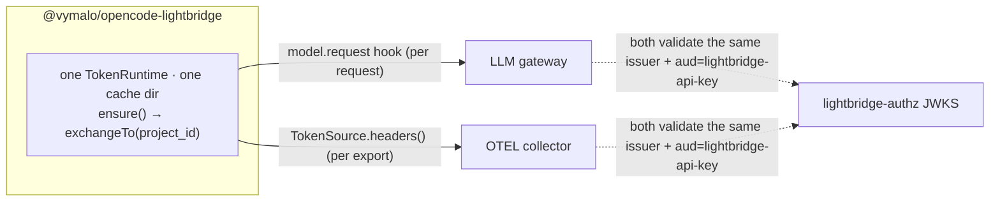
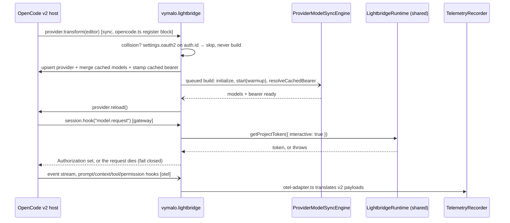
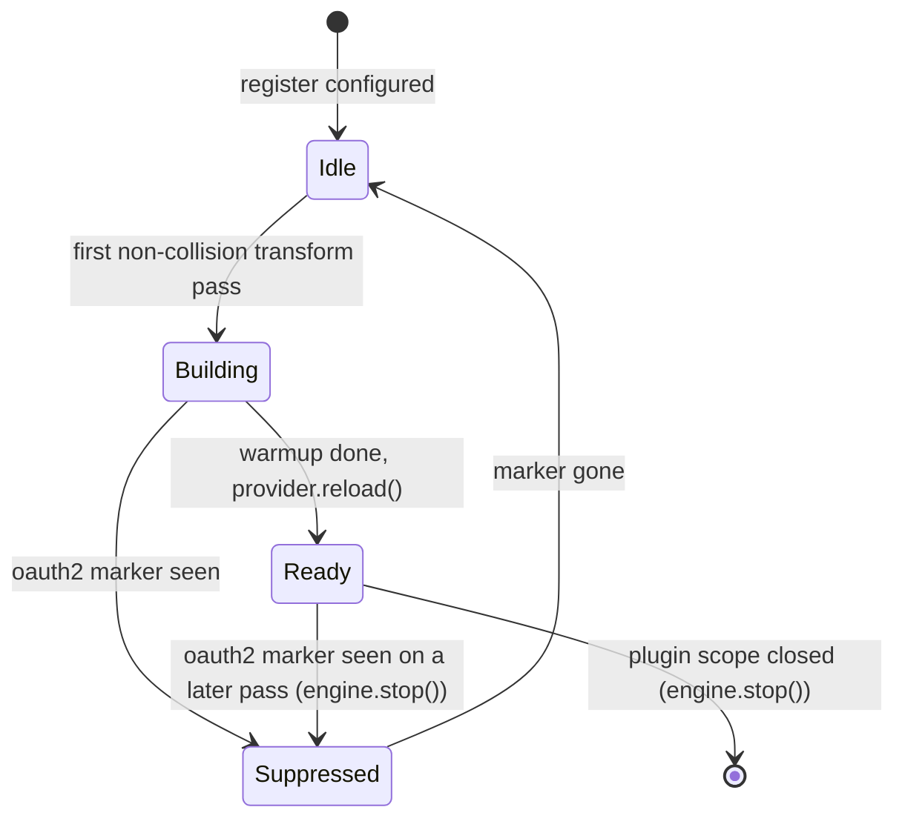

# `@vymalo/opencode-lightbridge` — the all-in-one plugin

Status: **implemented** — see [ADR-0012](adr/0012-single-auth-across-gateway-and-otel.md) (Accepted)
and [ADR-0017](adr/0017-lightbridge-all-in-one.md) (Accepted, amends ADR-0012), plus
`packages/opencode-lightbridge/`.

The umbrella plugin: **one shared credential** drives every egress a project needs — provider
registration + model discovery (`register`, ADR-0017 — "everything `@vymalo/opencode-oauth2` does"),
the LLM gateway bearer (`gateway`), and the OTEL export credential (`otel`). A developer
authenticates once as themselves; every module that needs a credential rides that same login. Since
ADR-0017, that login is ALSO shared with `@vymalo/opencode-oauth2` when both are configured against
the same IdP — see [One login, shared cache with oauth2](#one-login-shared-cache-with-oauth2-adr-0017)
below.

## Why this exists

Running `@vymalo/opencode-repo-auth` and `@vymalo/opencode-otel` side by side works, but each holds
its **own** credential in its **own** cache namespace — two logins, two token stores, no relationship
between the two even though the gateway and the governance OTEL collector accept the exact same
token. `@vymalo/opencode-lightbridge` closes that gap by composing `@vymalo/opencode-auth-core` (the
OAuth / RFC 8693 token-exchange primitive) and `@vymalo/opencode-core-otel` (the OTel engine — both
`@vymalo/opencode-otel` and this package build on it) over **one** `TokenRuntime`. No engine logic is
forked; this package is a thin composition layer plus two small injectors.

## The one-credential design



1. **Login once** — `ensure()` runs the configured OAuth flow (`authorization_code` with PKCE, or
   `device_code` for headless) against `auth.issuer`, producing the human root token
   (`offline_access` scope → silent refresh via its refresh token).
2. **Exchange once per project — OPT-IN since ADR-0017 (`gateway.exchange: true`).**
   `exchangeTo(projectKey, humanToken, projectId ? { project_id } : {})`, an RFC 8693 token exchange
   presenting `project_id` as a form param when configured (no `audience`, no mint step — same
   contract as `@vymalo/opencode-repo-auth`, see [ADR-0011](adr/0011-repo-auth-project-id-token-exchange.md)).
   **`projectId` is fully optional**: omit it and the exchange sends no `project_id`, so the backend
   mints a token for the caller's **default project**. The result is short-lived and carries no
   refresh token; renewal is always a fresh exchange from the human root ("model b").
   **Default (`gateway.exchange: false` or omitted): NO exchange** — the IdP access token from `auth`
   is used directly as the bearer. See [The exchange is opt-in](#the-exchange-is-opt-in-adr-0017)
   below for why the default flipped.
3. **Two injectors read the SAME cached project token:**
   - **Gateway** (`gateway` config block) — a `session.hook("model.request")` hook injects
     `Authorization: Bearer <project-token>` on the configured `providers`, per request. Fails
     closed: a token failure kills the request locally (see
     [Fail-closed gateway](#fail-closed-gateway-v2)).
   - **OTEL** (`otel` config block) — a `TokenSource` whose `headers()` calls the shared runtime,
     passed as the 5th argument to `@vymalo/opencode-core-otel`'s `createProviders`. The OTLP
     exporters already call `headers()` as an async factory before every export (see
     [ADR-0009](adr/0009-otel-otlp-http-not-grpc.md)), so this is refresh-aware with no new
     machinery — the seam already existed, this just points it at the shared runtime instead of a
     standalone credential helper (`tokenCommand`). `invalidate()` is a documented no-op in v1: the
     project token is short-lived and `getProjectToken` re-checks its own expiry on every call, so
     there is no stale in-memory copy to drop.
     **When the exchange fails, `headers()` resolves to `undefined`, not `{}`** — that tells
     `core-otel`'s export gate to skip the export before it reaches the network, rather than sending
     it unauthenticated for the collector to reject. See [ADR-0015](adr/0015-otel-fail-closed-credential-gate.md)
     and [`otel.md` → Fail-closed export](otel.md#fail-closed-export).

Both modules are independent opt-ins. `auth` alone (no `gateway`, no `otel`) is a valid, inert
config — the plugin logs once and registers no observing hooks.

## Configuration

```jsonc
// opencode.json
{
  "plugins": [
    {
      "package": "@vymalo/opencode-lightbridge",
      "options": {
        "auth": {
          "id": "lightbridge",
          "issuer": "https://authz.example.com/realms/lightbridge",
          "clientId": "opencode-cli",
          "scopes": ["openid", "offline_access"],
          "authFlow": "device_code"
        },
        "gateway": {
          "providers": ["gateway"],
          "exchange": false
        },
        "otel": {
          "endpoint": "http://localhost:4318"
        },
        "register": {
          "baseURL": "https://gateway.example.com/v1"
        }
      }
    }
  ]
}
```

The plugin id is `vymalo.lightbridge`. All of the above are the plugin's own `options`
(`ctx.options`), plus an optional `logLevel` (`TRACE`/`DEBUG`/`INFO`/`WARN`/`ERROR`; falls back to
the host's `OPENCODE_LOG_LEVEL`).

| Field | Required | Notes |
| --- | --- | --- |
| `auth` | yes | `AuthServerConfigInput` (auth-core) — the one IdP login. Validated eagerly via `validateAuthConfig`; a malformed block fails plugin load with a field-level error rather than a half-built plugin. `auth.id` is also the OpenCode provider id `register` uses AND the shared cache identity (see below). |
| `gateway.providers` | required if `gateway` is set | Which OpenCode provider ids get the bearer injected per request (`session.hook("model.request")`). |
| `gateway.exchange` | no, default `false` (ADR-0017) | `false`: use the IdP access token directly as the bearer. `true`: RFC 8693-exchange it for a project-scoped token first (ADR-0012's original behaviour). See [The exchange is opt-in](#the-exchange-is-opt-in-adr-0017). |
| `gateway.projectId` | no | Optional project id for the gateway exchange. Only meaningful when `gateway.exchange: true`. Omit for the caller's **default project**. |
| `otel` | no | Same shape as `@vymalo/opencode-otel`'s options. `tokenCommand` / `tokenHeader` / `tokenPrefix` are accepted (they are just `OtelPluginOptions` fields) but always **ignored** — the shared runtime's `TokenSource` supersedes that seam entirely and always wins in `createProviders`. Setting any of them logs `lightbridge_otel_token_command_ignored` once at `debug` rather than silently no-opping. |
| `register` | no (ADR-0017) | Register `auth`'s IdP as an OpenCode provider and keep its models in sync via the shared `ProviderModelSyncEngine` — see [`register`](#register--provider-registration--model-discovery-adr-0017) below. Independent of `gateway`/`otel`. |
| `register.baseURL` | required if `register` is set | Base URL of the OpenAI-compatible (or Responses) inference endpoint. |
| `register.name` | no | Display name for the registered provider. Defaults to `auth.id`. |
| `register.nameOverrides` | no | Raw model id → display name overrides, applied at discovery time (same shape as oauth2's `nameOverrides`). |
| `register.syncIntervalMinutes` | no, default `60` | Minutes between model-discovery syncs. |
| `register.responseApi` | no, default `false` | Route inference through the OpenAI Responses API instead of Chat Completions. |
| `projectId` (top-level) | no | Optional project id for the shared exchange. Only meaningful when `gateway.exchange: true`. When omitted (and no `gateway.projectId`), the backend mints a **default-project** token. An explicit top-level `projectId` wins over `gateway.projectId`. |

When the shared credential resolution itself fails (expired login, rejected exchange, no session at
all), `gateway` **fails the request** (the `model.request` hook dies, so nothing goes out — see
[Fail-closed gateway](#fail-closed-gateway-v2)); `otel`'s
`TokenSource.headers()` resolves to `undefined` on that call, which skips the export entirely rather
than sending it with no `Authorization` header. Both modules keep re-trying on their own natural
cadence (`gateway` on the next request, `otel` on the next batch flush), so a later successful login
resumes both without a restart.

## Module wiring (v2)





| Module | v2 registration | Source |
| --- | --- | --- |
| `register` | `provider.transform` (sync) + queued background engine build + `provider.reload()` | `packages/opencode-lightbridge/src/opencode.ts` (`register module` block) |
| `gateway` | `session.hook("model.request")` | same file, `gateway module` block |
| `otel` | `event.subscribe`, `session.hook("prompt" \| "context" \| "http.request")`, `tool.hook("execute.before" \| "execute.after")`, `permission.hook("evaluate")` | same file, `otel module` block; payload translation in `src/otel-adapter.ts` |

### Fail-closed gateway (v2)

`gateway` never stamps a bearer onto the provider record, so it creates no sticky header. But the
same provider id can carry a stamped `Authorization` from elsewhere: `register` stamps the raw IdP
token (`propagateCachedBearer`, for models-info), and oauth2 does the same for a provider it
manages. If `gateway.exchange: true` and the RFC 8693 exchange (a remote call) then fails, simply
*not setting* a header would let that stale stamped value go out. So a failed token resolution makes
the hook **die** (`Effect.orDie`, the mechanism oauth2 uses): the request does not leave the
process. The cause is logged first as `lightbridge_gateway_no_bearer` (`warn`). Both paths behave
the same: `exchange: false` fails when the IdP login is missing or expired and cannot be refreshed,
`exchange: true` additionally fails when the exchange is rejected.

## Migrating from v1

`0.18.0` targets the OpenCode **v2** plugin API; `0.17.x` was the last v1 release
([ADR-0019](adr/0019-opencode-v2-cutover.md)). There is no dual-support build.

| v1 | v2 |
| --- | --- |
| `"plugin": [["@vymalo/opencode-lightbridge", { ... }]]` | `"plugins": [{ "package": "@vymalo/opencode-lightbridge", "options": { ... } }]` |
| `Hooks.config` registered the provider into `config.provider[<auth.id>]` | `provider.transform` over the provider editor; `Provider.Info.package` / `settings.baseURL` |
| `npm: "@ai-sdk/openai-compatible"` | `package: "aisdk:@ai-sdk/openai-compatible"` (Responses: `aisdk:@ai-sdk/openai`) |
| `options.baseURL` / `options.apiKey` | `settings.baseURL` / `settings.apiKey` |
| `chat.headers` (gateway) | `session.hook("model.request")` |
| `event`, `chat.message`, `chat.params`, `tool.execute.*`, `permission.ask` | `event.subscribe`, `session.hook("prompt")`, `session.hook("context")`, `tool.hook`, `permission.hook("evaluate")` |
| trace propagation via `provider.options.fetch` | `session.hook("http.request")` |
| host `config.logLevel` drove the log level | `options.logLevel`, else `OPENCODE_LOG_LEVEL` |
| oauth2 collision read `pluginConfig.oauth2ModelSync.servers` and `provider.options.oauth2` | reads `settings.oauth2` / `settings.oauth2ModelSync` on the provider record |

## Behaviour changes in v2

- **Gateway failure now fails the request.** v1's `chat.headers` hook swallowed a failed token
  resolution (`lightbridge_gateway_no_bearer`, `trace`) and let the request go out without a bearer
  for the gateway to 401. v2 dies the hook, so the request is refused locally, and the same event is
  now logged at `warn`. See [Fail-closed gateway](#fail-closed-gateway-v2).
- **oauth2 collision detection is order-sensitive.** v1 read oauth2's private `pluginConfig`. A v2
  plugin cannot see another plugin's options, so lightbridge looks for the `settings.oauth2` marker
  oauth2 stamps on every provider it manages. List `@vymalo/opencode-oauth2` **before**
  lightbridge in `plugins`. If lightbridge is listed first it may start its engine on the first
  pass; it stands the engine down (`engine.stop()`, releasing its scheduler slot) as soon as a later
  pass shows the marker. The scheduler-ownership guard in `ProviderModelSyncEngine` still prevents
  two engines polling the same cache file in the meantime.
- **`oauth2ManagedProviderIds`, `OpenCodeConfigLike` and the config-shaped `hasOAuth2Conflict`
  signature are gone** from `./lib`; `hasOAuth2Conflict(editor, id)` replaces it (`ProviderLookup`).
- **`session.diff` / `todo.updated` / `command.executed` are no longer observed.** `@opencode/schema`
  2.2.6 has no `session.diff` or `todo.updated` event, and `command.executed` is not mapped, so the lines-of-code metric, the `opencode.file_edited` event and the
  todo/command counters stop being produced by the `otel` module. Session, message (step),
  tool, permission, retry, compaction, error and resource attributes are unchanged.
- **`experimental.compaction.autocontinue` is gone** (no v2 equivalent); the plain compaction event
  and counter remain.
- **Trace context now rides `http.request`** instead of a wrapped `options.fetch`; it composes with
  `@vymalo/opencode-ratelimit` regardless of order.
- **Events renamed:** none. Added: `lightbridge_register_build_failed` (a failed background engine
  build, `error`), `lightbridge_gateway_model_request_skipped` (`trace`),
  `lightbridge_otel_event_stream_failed` (`warn`). Removed: `lightbridge_gateway_chat_headers_skipped`
  (replaced by `lightbridge_gateway_model_request_skipped`).
- **A malformed config no longer returns an inert `config` hook**; the plugin logs
  `lightbridge_config_invalid` and registers nothing.
- **Not configurable any more:** nothing was dropped from `auth` / `gateway` / `otel` / `register`;
  `otel.tokenCommand` / `tokenHeader` / `tokenPrefix` were already ignored. The Responses-API SSE
  repair was never injected by lightbridge and still is not.

**Exit behaviour (`otel`).** When the `otel` module is active it flushes buffered telemetry on
`beforeExit`, and on `SIGINT`/`SIGTERM` it shuts the exporters down (waiting at most 2 s), then
re-raises the signal so the process still terminates with the usual status — a bare signal listener
would replace the runtime's default "terminate" action and leave `opencode serve` running. Where the
host also handles the signal (e.g. `opencode run`'s Ctrl-C), the plugin only flushes and never ends
the process. Same implementation as `@vymalo/opencode-otel`, events prefixed `lightbridge_otel_`; see
[ADR-0018](adr/0018-exit-handlers-reraise-the-signal.md) and [`otel.md` → Flushing](otel.md#flushing).

## `register` — provider registration + model discovery (ADR-0017)

`register` makes lightbridge do everything `@vymalo/opencode-oauth2` does: register `auth`'s IdP as
an OpenCode provider (`package`, `name`, `settings.baseURL`) and keep its model list in sync, via the
SAME `@vymalo/opencode-provider-sync` `ProviderModelSyncEngine` oauth2 builds on — not a fork. It is
independent of `gateway` (bearer injection) and `otel` (export credential): a config can register a
provider without ever routing chat traffic through it, though the common case sets
`gateway.providers` to the same id so both modules work together.

```jsonc
{
  "auth": { "id": "gateway", "issuer": "...", "clientId": "...", "scopes": ["openid"] },
  "register": { "baseURL": "https://gateway.example.com/v1" },
  "gateway": { "providers": ["gateway"] }
}
```

**Provider-id collision guard.** If `auth.id` is ALSO managed by `@vymalo/opencode-oauth2` in the
same host (the provider record carries `settings.oauth2` / `settings.oauth2ModelSync` — either the
user's own block or the `{ managed: true }` marker oauth2 stamps on providers it materialises from
its `options.servers`), lightbridge's `register` module skips entirely — no engine is built, the
provider is never touched, nothing is scheduled — logged once at `debug`
(`lightbridge_register_skipped_oauth2_conflict`; nothing reaches the terminal, per
[ADR-0014](adr/0014-suite-wide-no-terminal-mirror.md)). The gateway/OTEL bearer keeps working
regardless — see the next section.

## One login, shared cache with oauth2 (ADR-0017)

The human root token lives in the **same on-disk file** `@vymalo/opencode-oauth2` uses for a server
of this id: `<cacheRoot>/opencode-oauth2/opencode-oauth2-model-sync/<auth.id>.json`. Configure the
same `id`/`issuer`/`clientId` in both plugins and logging in through **either one** makes the token
available to **both** — no second device-code/browser flow.

This works whether or not `register` is configured:

- With `register`: lightbridge's own `ProviderModelSyncEngine` writes to that file directly, the
  same way oauth2's does.
- Without `register` (just `auth` + `gateway`/`otel`): `LightbridgeRuntime` reads/refreshes through
  a lightweight `TokenRuntime` pointed at the same file — it never runs a scheduler or its own
  model-discovery HTTP calls, so it cannot race oauth2's own polling; see
  [`docs/architecture.md` → Sync scheduler](architecture.md#sync-scheduler) for the ownership guard
  that protects the case where both DO run an engine for the same id.

**Scope:** only the human/IdP root token is shared. The project-scoped token produced by the
(opt-in) RFC 8693 exchange has no oauth2 equivalent and stays in its own store, unchanged
(`<cacheRoot>/opencode-lightbridge/lightbridge-<hash>.json`).

**Upgrading from a pre-ADR-0017 install?** Nothing to do — the first time the plugin needs the
root token, it transparently adopts a still-valid (or expired-but-refreshable) token from the OLD
location (`<cacheRoot>/opencode-lightbridge/lightbridge.json`) into the new shared file. No fresh
login is forced. The old file is left in place (non-destructive); this is a one-time, idempotent
check. The exchanged project token is NOT migrated (see Scope above) — worst case, one extra
exchange call on first use post-upgrade, not a re-login.

## The exchange is opt-in (ADR-0017)

Before ADR-0017, `gateway`/`otel` ALWAYS performed the RFC 8693 exchange described above. That is
now gated behind `gateway.exchange`, **defaulting to `false`** — a deliberate breaking change from
ADR-0012's original behaviour:

- **`false` (default):** the IdP access token from `auth` is used directly as the bearer for both
  `gateway` and `otel`. This is what our own fleet needs: the device-code token our IdP issues is
  already fully project-scoped, and the `opencode-cli` client has no `token-exchange` grant
  registered, so an unconditional exchange failed outright (`unauthorized_client`).
- **`true`:** ADR-0012's original behaviour, unchanged — exchange the human token for a
  project-scoped one (`gateway.projectId`/top-level `projectId`, or the caller's default project)
  before using it as the bearer.

**If you relied on the exchange before upgrading, set `gateway.exchange: true` explicitly** — see
the `CHANGELOG.md` `## [Unreleased]` entry for the exact migration note.

## Scope: gateway + OTEL, not MCP

MCP is deliberately excluded. OpenCode mints its own per-server MCP OAuth token into
`mcp-auth.json`, and `McpRemoteConfig.headers` is a static map with no per-request hook — sharing this
plugin's credential there would need a stdio credential-proxy sidecar, which is not worth the added
complexity today. MCP keeps using OpenCode's native per-server OAuth. See
[ADR-0012 → Alternatives considered](adr/0012-single-auth-across-gateway-and-otel.md#alternatives-considered).

## Relationship to the standalone plugins

`@vymalo/opencode-lightbridge` does not replace `@vymalo/opencode-oauth2`, `@vymalo/opencode-repo-auth`
or `@vymalo/opencode-otel` — since ADR-0017 it is a genuine **superset**: `register` covers
everything oauth2 does, `gateway` covers repo-auth's bearer-injection role, `otel` covers the
standalone otel plugin. Run the standalone plugins when you want per-concern isolation (e.g.
different IdPs per egress) or don't need the shared-login story; run `opencode-lightbridge` when you
want one plugin entry, one login, driving as many of the three modules as you need. All three
combinations of `gateway`/`otel`/`register` are independent opt-ins — an `auth`-only config remains
valid and inert.

| | Standalone (`oauth2` + `repo-auth` + `otel`) | `opencode-lightbridge` |
| --- | --- | --- |
| Logins (same IdP) | up to 3 (separate `TokenRuntime`s, separate cache dirs) | 1 (shared with oauth2 when `id`/`issuer`/`clientId` match — see [above](#one-login-shared-cache-with-oauth2-adr-0017)) |
| Provider registration + model discovery | oauth2 only | `register` (ADR-0017) — same engine, same behaviour |
| Cache namespace | `opencode-oauth2/` + `opencode-repo-auth/` + otel's `tokenCommand` (external) | `opencode-oauth2/…/<id>.json` (shared root) + `opencode-lightbridge/` (exchanged project token only) |
| OTEL credential | static header or external `tokenCommand` helper | the same shared credential as the gateway |
| RFC 8693 exchange | repo-auth: always | lightbridge: opt-in (`gateway.exchange`, ADR-0017) |
| Config | up to three separate `plugin` entries | one `plugin` entry, up to three option blocks |

## Package layout

Mirrors the per-package convention (see `AGENTS.md`), **minus `cache.ts`** (auth-core's/provider-sync's
`FileCacheStore`, reached through `TokenRuntime`/`ProviderModelSyncEngine`, owns persistence):

```
packages/opencode-lightbridge/
├── src/
│   ├── index.ts     # slim entry — single `export { default } from "./opencode.js"`
│   ├── opencode.ts  # plugin factory: createLightbridgePlugin(opts) → Plugin; register + gateway + otel registrations
│   ├── otel-adapter.ts # v2 events/hooks → core-otel recorder inputs (pure, host-free)
│   ├── logging.ts   # captureHostContext + createEffectLogger (ADR-0014/0019)
│   ├── plugin.ts    # LightbridgeRuntime — the shared root-token wrapper (ensure/exchange/shared cache)
│   ├── migration.ts # ADR-0017: one-time old-cache → shared-cache root-token migration
│   ├── config.ts    # pluginOptions parsing + validation → LightbridgeOptions
│   └── lib.ts       # public API (embedders)
└── test/            # vitest, *.test.ts
```

## Security posture

Same posture as `@vymalo/opencode-repo-auth`, extended to the OTEL egress and `register`:

- **Fail closed** — a token-resolution failure means no gateway request and, for OTEL, no export
  attempt at all (not just no `Authorization` header — see
  [ADR-0015](adr/0015-otel-fail-closed-credential-gate.md)). No module ever invents a token.
- **Two cache locations, by design (ADR-0017)** — the shared human root token lives at
  `<cacheRoot>/opencode-oauth2/opencode-oauth2-model-sync/<auth.id>.json` (shared with oauth2 on
  purpose); the exchanged project-scoped token (only when `gateway.exchange: true`) stays at
  `<cacheRoot>/opencode-lightbridge/` (lightbridge-exclusive, no oauth2 equivalent).
- **Redaction** — auth-core's logger redacts `token|secret|password` fields.
- **Disk** — `0o600` files, atomic rename (auth-core `FileCacheStore`, [ADR-0005](adr/0005-atomic-file-writes-per-writer-temp.md)).
- **No content capture** — the OTEL half inherits `@vymalo/opencode-core-otel`'s privacy posture
  (no prompts/responses/tool arguments in telemetry; see [`otel.md` → Privacy](otel.md)).

## Related

- [ADR-0012](adr/0012-single-auth-across-gateway-and-otel.md) — the original design decision and alternatives considered.
- [ADR-0017](adr/0017-lightbridge-all-in-one.md) — `register`, the shared cache with oauth2, and the exchange becoming opt-in.
- [ADR-0016](adr/0016-provider-sync-extraction.md) — the `ProviderModelSyncEngine` `register` is built on.
- [`docs/architecture.md`](architecture.md) — `@vymalo/opencode-oauth2`'s own doc; `register` reuses its model-sync engine and cache contract.
- [`repo-auth.md`](repo-auth.md) — the project-token exchange contract this package reuses verbatim.
- [`otel.md`](otel.md) — the OTEL config surface (`endpoint`, `exporters`, `serviceName`, …) this package reuses via `@vymalo/opencode-core-otel`.
