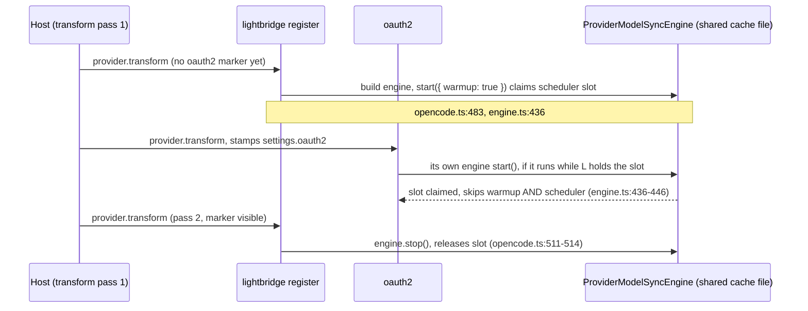

# Migrating to OpenCode v2 (`0.18.0`)

What changes in your `opencode.json` and your install when you move the `@vymalo/*` plugins from the OpenCode v1 plugin API (`0.17.x`, the last v1 line) to v2 (`0.18.0`). The decision record is [ADR-0019](adr/0019-opencode-v2-cutover.md); the porting order is in [`plans/opencode-v2.md`](../plans/opencode-v2.md).

This is a **hard cutover**. `0.18.0` targets `@opencode/plugin` and does not run on OpenCode v1; there is no dual export and no compatibility mode. Upgrade OpenCode and the plugins together, and rewrite your config once.

Each package's README also has a "Migrating from v1" table with the package-specific rows. This page is the cross-cutting version, plus the things no single package owns: ordering, `effect`, and the removals.

> **How this page was checked.** Plugin-side claims are backed by `file:line` against the tree at the `0.18.0` cut. The host-level renames (`plugin` to `plugins`, and so on) are OpenCode's, not ours; they are confirmed against OpenCode's own [v1 migration guide](https://opencode.ai/docs/migrate-v1), not against code in this repo.

## Staying on v1

Not ready to move to OpenCode v2? You do not have to yet.

- **`0.18.0` and later require an OpenCode v2 host.** They do not run on v1.
- **`0.17.0` is the last v1-compatible release** of all thirteen published packages, and it stays on npm indefinitely. Its dependencies are pinned (`@opencode-ai/plugin` at `1.15.10`, and its sibling `@vymalo/*` packages at `0.17.0`), so it keeps resolving.
- **Install it by version, which always works:** `npm i @vymalo/opencode-oauth2@0.17.0` (and the same for each other package you use, all at `0.17.0`). Once a maintainer has applied it, the `opencode-v1` dist-tag points at the same version: `npm i @vymalo/opencode-oauth2@opencode-v1`. The tag is a convenience, not a separate release.
- **v1 is frozen.** No fixes, security or otherwise, will be backported to `0.17.x`. This is a way to defer the upgrade, not to avoid it. The tag is not called `v1` because npm rejects any dist-tag that parses as a SemVer range, and `v1` is one (`1.x`).

Pin exact versions in your OpenCode config so a plain `@latest` never pulls `0.18.0` into a v1 host.

## 1. Config shape

Three things moved, and they do **not** move uniformly across the plugins. Read your plugin's row in [section 2](#2-per-plugin-opt-in-keys) before assuming.

### 1.1 Host keys (OpenCode's, not ours)

| v1 | v2 |
| --- | --- |
| `"plugin": [...]` | `"plugins": [...]` |
| `"plugin": [["pkg", { ... }]]` (tuple) | `"plugins": [{ "package": "pkg", "options": { ... } }]` |
| `"provider": { ... }` | `"providers": { ... }` |
| `"npm": "@ai-sdk/openai-compatible"` | `"package": "aisdk:@ai-sdk/openai-compatible"` |
| provider `options.baseURL` / `options.apiKey` | provider `settings.baseURL` / `settings.apiKey` |
| provider `options.headers` | provider `headers` |

A bare string entry (`"plugins": ["@vymalo/opencode-models-info"]`) is still fine for a plugin you do not configure. The `aisdk:` prefix is also what our own code writes when it registers a provider (`packages/opencode-provider-sync/src/opencode-helpers.ts:34-35`).

### 1.2 Per-provider opt-ins: `options.meta.<key>` becomes `settings.<key>`

OpenCode v2's `Provider.Info` has no `options` field. `settings` is an open struct, so the suite's per-provider opt-ins moved up into it, flat, beside `baseURL`.

```jsonc
// v1
{
  "plugin": ["@vymalo/opencode-models-info", "@vymalo/opencode-ratelimit"],
  "provider": {
    "my-provider": {
      "npm": "@ai-sdk/openai-compatible",
      "options": {
        "baseURL": "https://api.example.com/v1",
        "meta": {
          "modelsInfoUrl": "https://api.example.com/v1/models",
          "rateLimit": { "enabled": true, "maxRetries": 5 }
        }
      }
    }
  }
}
```

```jsonc
// v2
{
  "plugins": ["@vymalo/opencode-models-info", "@vymalo/opencode-ratelimit"],
  "providers": {
    "my-provider": {
      "package": "aisdk:@ai-sdk/openai-compatible",
      "settings": {
        "baseURL": "https://api.example.com/v1",
        "modelsInfoUrl": "https://api.example.com/v1/models",
        "rateLimit": { "enabled": true, "maxRetries": 5 }
      }
    }
  }
}
```

Note that `modelsInfo*` keys lose the `meta` wrapper and sit directly on `settings`; `rateLimit` keeps its own block, just moved up one level. The fields *inside* the `rateLimit`, `repoAuth` and `oauth2` blocks are unchanged.

### 1.3 Plugin configuration: `pluginConfig` becomes the plugin's own `options`

v2 has no `pluginConfig` and no shared config object. A plugin's options are whatever sits in its `plugins` entry, and the plugin sees them as `ctx.options` (nobody else can read them).

This was **not** one uniform change, because v1 was not uniform:

- **oauth2** is the only plugin that used `pluginConfig` (`pluginConfig.oauth2ModelSync.{servers, cacheNamespace, httpTimeoutMs, tokenExpirySkewMs}`). Those keys now live at the top of its `options`.
- **devtools, browser, otel, lightbridge** already took options as the second element of a tuple entry. The option names are unchanged; only the tuple becomes `{ "package", "options" }`.
- **ratelimit, models-info, repo-auth** had no plugin options in v1 at all. They gain exactly one: `logLevel` (see [1.4](#14-log-level)).

```jsonc
// v1: oauth2 with a plugin-level server list
{
  "plugin": ["@vymalo/opencode-oauth2"],
  "pluginConfig": {
    "oauth2ModelSync": {
      "servers": [{ "id": "example-ai", "issuer": "https://auth.example.com",
                    "baseURL": "https://api.example.com/v1", "clientId": "opencode-client" }],
      "httpTimeoutMs": 10000
    }
  }
}
```

```jsonc
// v2
{
  "plugins": [
    {
      "package": "@vymalo/opencode-oauth2",
      "options": {
        "servers": [{ "id": "example-ai", "issuer": "https://auth.example.com",
                      "baseURL": "https://api.example.com/v1", "clientId": "opencode-client" }],
        "httpTimeoutMs": 10000
      }
    }
  ]
}
```

oauth2 reads those from `ctx.options` at `packages/opencode-oauth2/src/opencode.ts:165-169` and `:246`. The provider-embedded form (`options.oauth2` on a provider, v1 "Option A") becomes `settings.oauth2`:

```jsonc
// v1
"provider": { "example-ai": { "options": { "baseURL": "...", "oauth2": { "issuer": "...", "clientId": "..." } } } }
// v2
"providers": { "example-ai": { "settings": { "baseURL": "...", "oauth2": { "issuer": "...", "clientId": "..." } } } }
```

devtools, browser, otel and lightbridge:

```jsonc
// v1
{ "plugin": [["@vymalo/opencode-devtools", { "groups": ["math", "http"] }]] }
// v2
{ "plugins": [{ "package": "@vymalo/opencode-devtools", "options": { "groups": ["math", "http"] } }] }
```

### 1.4 Log level

v1 plugins took their log level from the host's `config.logLevel`. v2 gives plugins no config object, so every plugin now resolves it as: its own `options.logLevel`, else the `OPENCODE_LOG_LEVEL` environment variable, else the default. All eight runtime plugins do this (`resolveLogLevel(ctx.options.logLevel) ?? resolveLogLevel(process.env.OPENCODE_LOG_LEVEL)`; e.g. `packages/opencode-ratelimit/src/opencode.ts:56-57`).

**The level is gated twice.** A record passes the plugin's own gate and then the host's Effect logger, whose default minimum is `Info`. So `"logLevel": "debug"` on its own surfaces nothing below `info`; you also need `OPENCODE_LOG_LEVEL=DEBUG` ([ADR-0019](adr/0019-opencode-v2-cutover.md), "Consequences"). Under v1 the plugin's gate was the only one. This is the likeliest "my trace events are missing" report.

### 1.5 `.well-known/opencode`

Served `config` blocks use the same renames as above (`plugins`, `providers`, `settings`). The manifest itself is reshaped by OpenCode v2; see [`well-known.md`](well-known.md) and [ADR-0020](adr/0020-oauth2-integration-domain.md) for what this suite does with it.

## 2. Per-plugin opt-in keys

"Per-provider" keys go on a provider record (`providers.<id>.settings`). "Plugin" keys go in the plugin's `plugins` entry `options`. All keys below were read out of each package's `src/`, not out of the docs.

| Plugin | Per-provider opt-in: v1 | Per-provider opt-in: v2 | Plugin `options` (v2) | Backing |
| --- | --- | --- | --- | --- |
| `@vymalo/opencode-ratelimit` | `options.meta.rateLimit` | `settings.rateLimit` | `logLevel` | `packages/opencode-ratelimit/src/config.ts:8,108-110` |
| `@vymalo/opencode-models-info` | `options.meta.modelsInfoUrl`, `…TtlSeconds`, `…TimeoutMs`, `…Headers`, `…Overwrite`, `…HideTextOnly`, `…HideInternal`, `…HideUnmatched` | the same names, flat on `settings` | `logLevel` | `packages/opencode-models-info/src/config.ts:97-119` |
| `@vymalo/opencode-repo-auth` | `options.meta.repoAuth` | `settings.repoAuth` | `logLevel` | `packages/opencode-repo-auth/src/config.ts:7,138` |
| `@vymalo/opencode-oauth2` | `options.oauth2`, `options.oauth2ModelSync` | `settings.oauth2`, `settings.oauth2ModelSync` | `servers`, `cacheNamespace`, `httpTimeoutMs`, `tokenExpirySkewMs`, `logLevel` | `packages/opencode-oauth2/src/opencode.ts:34,115,165-169,246` |
| `@vymalo/opencode-lightbridge` | none (a plugin-level block) | none | `auth`, `gateway`, `otel`, `register` blocks, plus `logLevel` | `packages/opencode-lightbridge/src/opencode.ts:390,402` |
| `@vymalo/opencode-otel` | none | none | the `OtelPluginOptions` fields (`endpoint`, `exporters`, `serviceName`, …) plus `logLevel`; `OTEL_*` env still overrides | `packages/opencode-otel/src/opencode.ts:77,90` |
| `@vymalo/opencode-devtools` | none | none | `enabled`, `groups`, `http.{allowPrivateNetwork,timeoutMs}`, `logLevel` | `packages/opencode-devtools/src/types.ts:19-42`, `opencode.ts:40,53` |
| `@vymalo/opencode-browser` | none | none | `enabled`, `host`, `port`, `token`, `executor`, `groups`, `timeoutMs`, `screenshotDir`, `logLevel` | `packages/opencode-browser/src/types.ts:25-51`, `opencode.ts:98,110` |

Two rows need a note:

- **lightbridge** also has a provider-level touchpoint. When its `register` module owns a provider, it writes `package`/`settings.baseURL` on that provider itself, and it reads `settings.oauth2` / `settings.oauth2ModelSync` to detect that oauth2 already manages the same id (`packages/opencode-lightbridge/src/config.ts:251-271`). You do not write that marker by hand; oauth2 does (`packages/opencode-oauth2/src/opencode.ts:71-84`).
- **repo-auth** only *reads* `settings.oauth2*` (as a conflict guard, `packages/opencode-repo-auth/src/config.ts:192-206`). Never enable repo-auth and oauth2 on the same provider.

`screenshotDir` in browser now resolves against the plugin's `location.project.directory` rather than v1's `ctx.worktree` ([browser README](../packages/opencode-browser/README.md#migrating-from-v1)).

## 3. `effect` is a peer dependency

Every runtime plugin, and `@vymalo/opencode-provider-sync`, declares `effect` as `"peerDependencies": { "effect": "^4.0.0" }` plus a `devDependency`, and **never** as a runtime `dependency`. The nine `package.json` files are `ratelimit`, `models-info`, `devtools`, `browser`, `oauth2`, `otel`, `repo-auth`, `lightbridge` and `provider-sync`.

Why: the plugins are authored on the Effect surface so their logs reach OpenCode's own log file. Effect carries loggers as fiber-level references, so only the host's `effect` instance can reach the host's logger. OpenCode's `@opencode/plugin` README says the loader resolves a plugin's `effect` imports (including those inside the plugin's `node_modules`) to the host's instance "so fibers, loggers, and `Schema` parsers share one copy", and instructs plugin authors to keep `effect` external when bundling ([ADR-0014](adr/0014-suite-wide-no-terminal-mirror.md), [ADR-0019](adr/0019-opencode-v2-cutover.md)).

What this means for you:

- **Do not vendor or bundle `effect` into a plugin file.** A copy inlined into a bundle is not the host's, so its fibers see Effect's *default* logger. Per ADR-0019 that logger writes to the terminal, not to OpenCode's log file. You would see plugin diagnostics on the TUI or not at all, with no error and no type failure.
- **Do not depend on an Effect 3 library from a plugin's tree.** OpenCode's README states that dependencies built on another `effect` major are not supported.
- **Package managers that auto-install peers** will pull a compatible `effect` for type resolution; at runtime OpenCode substitutes its own. You do not need to match versions exactly, only stay in `^4.0.0`.
- **If you ship the oauth2 plugin as a single file**, `@vymalo/opencode-oauth2-bundle` keeps `effect` and `@opencode/plugin` external for exactly this reason, and fails its own build if either is inlined ([#143](https://github.com/ADORSYS-GIS/lightbridge-opencode-toolbeit/pull/143); `packages/plugin-bundle/rolldown.config.mjs`, `packages/plugin-bundle/scripts/check-artifact.mjs`). The bundle is a private workspace package, not published.

How to spot it: if a plugin loads but its log lines show up in your terminal (or nowhere) instead of OpenCode's log file, check for a second `effect` in the plugin's own bundle first. The supported check is that your build config lists `effect` and `@opencode/plugin` as externals.

## 4. Plugin ordering

Config hooks no longer exist, so there is no assembled config for plugins to mutate in order. Instead each plugin registers transforms on the host's domains, and **within a domain transforms run in `plugins` order** (`docs/models-info.md` "cross-plugin handoff"). Three couplings survive and depend on that order.

**Required order: oauth2 first.**

1. `@vymalo/opencode-oauth2` before `@vymalo/opencode-models-info`.
2. `@vymalo/opencode-oauth2` before `@vymalo/opencode-lightbridge`.
3. `@vymalo/opencode-oauth2` before `@vymalo/opencode-repo-auth` (and do not enable both on one provider).
4. `@vymalo/opencode-repo-auth` before `@vymalo/opencode-models-info` if your `modelsInfoUrl` is protected by the repo-auth bearer ([`repo-auth.md` "Composition contract"](repo-auth.md#composition-contract)).

`ratelimit`, `browser`, `devtools` and `otel` have no ordering requirement.

Treat 1 to 3 as requirements, not preferences. The cost of a wrong order differs per pair:

### oauth2 after models-info

oauth2 stamps its bearer on `Provider.Info.headers.Authorization` inside its provider transform (`propagateCachedBearer`); models-info reads it from there when it fetches an auth-protected `modelsInfoUrl`. Listed the wrong way round, the first fetch goes out unauthenticated and fails with `models_info_fetch_failed_no_cache` (HTTP 401). models-info does retry, exactly once per distinct provider header set (`packages/opencode-models-info/src/plugin.ts:214-224`), so a later reload that shows the stamped header can recover, but you are depending on that reload happening. If the endpoint is public, nothing visible goes wrong.

### oauth2 after lightbridge

lightbridge cannot read oauth2's private options, so it detects a collision through the `settings.oauth2` marker oauth2 stamps on every provider it manages. In `plugins` order, oauth2's transform has not run yet on lightbridge's first pass, so no marker is visible. Consequences, from the code:



- lightbridge builds an engine and runs a warmup sync against the shared root-token cache before it sees the marker (`packages/opencode-lightbridge/src/opencode.ts:483`).
- When a later pass shows the marker, it stops the engine and releases its scheduler slot (`:511-514`, and `:485-487` if it notices mid-warmup). That part self-heals.
- A scheduler-ownership guard stops two engines in one process from polling the same cache file at once: the engine that loses the claim skips its warmup and scheduler and only serves cached and on-demand reads (`packages/opencode-provider-sync/src/engine.ts:436-446`).

The stated cost is a wasted warmup, log noise, and a window where lightbridge holds the slot. **Read the last point carefully.** The losing engine does not retry the claim: `start()` just `continue`s and marks itself started (`engine.ts:446,483`). So if oauth2's engine happens to start while lightbridge's warmup holds the slot, oauth2 can end up with no periodic model sync for that provider in that process, even after lightbridge stands down. This follows from reading the code; it has not been reproduced. It is a further reason to list oauth2 first.

### oauth2 after repo-auth

repo-auth's first pass can claim an oauth2-managed provider until oauth2's reload shows the marker and a later pass drops it ([`repo-auth.md`](repo-auth.md)). Same shape as above: self-correcting, but not free.

## 5. Removals

### 5.1 `@vymalo/opencode-code-index`

Dropped at the cutover ([#132](https://github.com/ADORSYS-GIS/lightbridge-opencode-toolbeit/pull/132)), with its `docs/` and `plans/` pages; ADR-0002 to ADR-0004 were withdrawn. It was private and experimental and never published to npm, so no registry user is affected. If you wired a local checkout into a config, delete the `plugins` entry; there is no replacement and no `code_*` tools.

### 5.2 `@vymalo/opencode-core-otel` `./lib` and the signals it fed

The `otel` and `lightbridge` plugins are unaffected as *code*: they consume the engine internally. These removals bite in two places.

**Direct `./lib` consumers (breaking).** Compared against the last v1 release, `0.17.1` (`dfe4da4`), `packages/opencode-core-otel/src/lib.ts` and the recorder changed as follows:

| Removed or changed | Detail |
| --- | --- |
| `detectLanguage` | no longer exported (`lib.ts:18` at `0.17.1`; deleted by [#140](https://github.com/ADORSYS-GIS/lightbridge-opencode-toolbeit/pull/140)) |
| `Instruments.linesOfCode`, `Instruments.commands` | instruments removed (#140) |
| `session.diff`, `todo.updated`, `command.executed` recorder paths | handlers and event variants deleted (#140) |
| `TelemetryRecorder.onEvent(event)` | now takes the engine's own `RecorderEvent`, not the v1 SDK event type |
| `onTextComplete`, `onPermissionAsk`, `onToolAfter` | signatures changed (`onTextComplete(messageID, text)`, `onToolAfter(input, result?)`); see [`otel.md`](otel.md#migrating-from-v1) |
| `onCompactionAutocontinue` | removed ([#134](https://github.com/ADORSYS-GIS/lightbridge-opencode-toolbeit/pull/134)) |
| `Hooks`-derived input types | replaced by the engine's own types, newly exported from `./lib` |

`FileDiff` and `TodoInfo` were exported from `./lib` only between #134 and #140, never in a release, so relative to `0.17.1` there is nothing to migrate for them.

**Operators with dashboards or alerts (silent).** The following are no longer produced at all. A panel or alert built on one of them will go quiet **without erroring**, so look for them before you upgrade:

| Signal | Kind |
| --- | --- |
| `opencode.lines_of_code.count` | metric |
| `opencode.command.executed.count` | metric |
| `opencode.file_edited` | log |
| `opencode.todo_updated` | log |
| `opencode.command_executed` | log |
| `opencode.compaction_autocontinue` | log |

Why: v2's event stream has no source for them ([`otel.md` "Dropped in the v2 port"](otel.md#dropped-in-the-v2-port)). The first five are documented there. The sixth is removed too (the engine no longer has `onCompactionAutocontinue`, #134; `experimental.compaction.autocontinue` has no v2 equivalent), but `otel.md` does not list it. The plain `opencode.compaction` signal is still emitted. Also dropped: per-error `opencode.error.retryable` on terminal failures. There is no replacement for any of these; remove or re-point the panel.

## 6. If it breaks, check this first

| Symptom | Check first |
| --- | --- |
| Plugin does nothing; no log lines for it at all | The config still says `plugin` (singular) or uses a tuple entry. v1 keys are not read. Use `plugins` with a string or `{ "package", "options" }`. Then confirm the plugin was installed at `0.18.0` and OpenCode is v2. See [Generic: see exactly what the plugin is doing](troubleshooting.md#generic-see-exactly-what-the-plugin-is-doing); note its `jq`-on-terminal recipe predates v2, and logs now go to OpenCode's log file. |
| A provider is missing, or has no models | oauth2: search the OpenCode log for `oauth2_config_invalid`. Invalid config no longer rejects load; the plugin logs it and manages **no** providers (`packages/opencode-oauth2/README.md`, "Behaviour changes in v2"). Also check you moved `options.oauth2` to `settings.oauth2` and `"npm"` to `"package": "aisdk:..."`. For lightbridge, look for `lightbridge_register_skipped_oauth2_conflict` (it stood down because oauth2 owns the id). On a first launch providers may also appear before their models, which arrive after a background warmup and a reload. |
| `rateLimit`, `modelsInfoUrl` or `repoAuth` seems ignored | The opt-in is still under `options.meta`. v2 reads only `settings.<key>`; a left-behind `meta` block is silently ignored. |
| 401 on the metadata fetch (`models_info_fetch_failed_no_cache`) | oauth2 (or repo-auth) must be listed before models-info; see [section 4](#4-plugin-ordering). Set `logLevel: "trace"` on models-info **and** `OPENCODE_LOG_LEVEL=DEBUG`, then read `models_info_provider_headers_resolved`. Full diagnosis: [troubleshooting.md](troubleshooting.md#models_info_fetch_failed_no_cache-http-401--metadata-not-enriched). |
| Enrichment is missing on the very first model list | Expected. models-info now enriches through `model.transform` plus a reload, so the first list a session sees can be un-enriched ([`models-info.md`](models-info.md)). |
| `logLevel: "debug"` set, nothing below `info` appears | Both gates must be open: `OPENCODE_LOG_LEVEL=DEBUG` as well ([1.4](#14-log-level)). |
| Plugin logs on the terminal, or nowhere | A bundled second `effect`; see [section 3](#3-effect-is-a-peer-dependency). |
| A dashboard or alert went silent after upgrading | One of the six removed signals in [5.2](#52-vymaloopencode-core-otel-lib-and-the-signals-it-fed). |
| Telemetry stops or never starts | [troubleshooting.md](troubleshooting.md#plugin-appears-to-do-nothing-vymaloopencode-otel). |
| A request is refused locally instead of 401ing at the gateway | lightbridge's gateway module now fails closed when it cannot resolve a bearer (`lightbridge_gateway_no_bearer`, `warn`), where v1 sent the request without one ([lightbridge README](../packages/opencode-lightbridge/README.md)). |
