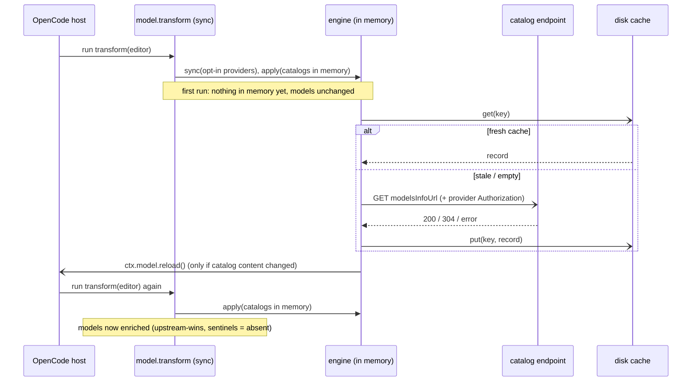
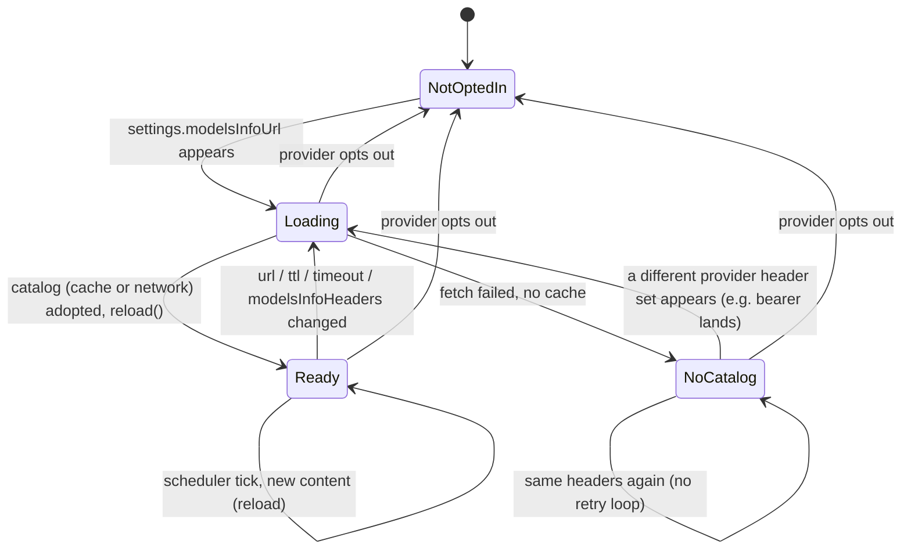

# Model metadata enrichment

How `@vymalo/opencode-models-info` runs inside OpenCode **v2**: the registrations it makes, how it composes with any auth scheme, where it caches, how it stays fresh over a long-lived process, and what happens when the metadata endpoint misbehaves.

For the copy-paste config reference (every option, the full OpenRouter→OpenCode field-mapping table, the v1→v2 migration table), see the package README: [`packages/opencode-models-info/README.md`](../packages/opencode-models-info/README.md). This page is for the adopter who needs to reason about composition and failure modes. The original design rationale lives in [`plans/models-info-plan.md`](../plans/models-info-plan.md); the v2 cutover is [ADR-0019](adr/0019-opencode-v2-cutover.md).

## What it does

OpenCode supports rich per-model metadata — context window, output limit, USD-per-1M-token cost, and capability flags — but you normally hand-write it in config. If your provider exposes an OpenRouter-shaped `/models` endpoint, this plugin fetches it once, merges the metadata onto your model entries, caches the result, and stays out of the way.

You point the plugin at that endpoint with `settings.modelsInfoUrl` on the provider — **the HTTP(S) URL (absolute, or a path resolved against `settings.baseURL`) that returns the metadata JSON**: `{ "data": [ { "id", "context_length", "pricing", … } ] }`. This JSON is commonly called the **OpenRouter shape** (it's what OpenRouter's `/models` returns), but the plugin has no dependency on OpenRouter and never contacts it — any endpoint that returns the shape works: a self-hosted gateway, a LiteLLM proxy, or a custom metadata route. The compatibility bar is low: a bare top-level array (no `data` wrapper) is accepted, and the field mapping is partial, so an endpoint only needs to emit the fields you want enriched.

> **Not the vanilla `/v1/models`.** A standard OpenAI-compatible `/v1/models` returns only `id` / `object` / `owned_by` — none of the fields this plugin maps. Pointing `modelsInfoUrl` at it fetches successfully and enriches nothing. The URL must return the richer OpenRouter shape.

It is **auth-agnostic** and does **not** depend on `@vymalo/opencode-oauth2`. It only edits models already in the host's model set, so it works with static API keys, oauth2, or no auth at all.

## The registrations

v2 has no mutable global config object and no `config` hook; a plugin registers changes with the domain that owns them. This plugin makes two registrations (plus one scope finalizer that stops its schedulers). Source: [`packages/opencode-models-info/src/opencode.ts`](../packages/opencode-models-info/src/opencode.ts).





1. **`ctx.model.transform(editor => …)`** — the enrichment. Transform callbacks must be **synchronous and cheap**, but the catalog fetch is async, so the transform **never awaits**. On each run it:
   1. reads the opt-in set from `editor.provider.list()` (`settings.modelsInfoUrl`, etc.) — the opt-in is only visible from inside a transform, which is why the first fetch is started by the first transform run, not before it;
   2. starts a background load for any opted-in provider that has no catalog in memory (cache → network);
   3. applies whichever catalogs are already in memory to `editor.list(providerId)` via `editor.update(...)` / `editor.remove(...)`.

   When a load lands and the catalog **content actually changed** (fingerprinted, so an `ETag` 304 or an identical re-fetch does not), the plugin calls **`ctx.model.reload()`** and the host runs the transform again, now with the data in hand. **Consequence versus v1:** v1's `config` hook could `await` the fetch, so models were enriched before anything saw them. In v2 the very first model list a session sees can be un-enriched; enrichment appears after one reload (immediately, when the disk cache is warm). Plan for that if you gate anything on the first model list.
2. **`ctx.provider.transform(editor => …)`** — a **read-only observer**. It only records each provider's `headers`. It exists as a fallback for the Authorization handoff — see [Auth composition](#auth-composition).

Providers load independently; one bad endpoint never blocks another's enrichment, and any unexpected throw is surfaced as a `models_info_enrichment_failed` log event rather than propagating into the host.

## Placeholder (sentinel) values are "absent" — read this if oauth2 discovers your models

v1 let a plugin write *only the fields it knew* onto a model entry, so "is this field already set?" was a plain `=== undefined` check. **v2's `Model.Info` requires every field.** A plugin that discovers a model with only an id and a name (`@vymalo/opencode-provider-sync`, the engine behind oauth2's and lightbridge's model sync) cannot leave the rest blank, so it fills them with **sentinels that mean "unknown"**. If upstream-wins treated those as real values, models-info would silently stop enriching exactly the models it exists for.

So upstream-wins here is **placeholder-aware**. A field counts as *absent* (and is filled from the catalog) when it holds its sentinel:

| `Model.Info` field | Sentinel (= unknown) | Counts as a real value |
| --- | --- | --- |
| `limit` | `{ context: 0, output: 0 }` (both zero) | anything else, including a one-sided zero |
| `cost` | `[]` | any non-empty array (even an all-zero tier — free is a real answer) |
| `capabilities.tools` | `false` | `true` |
| `capabilities.input` / `.output` | `[]` | any non-empty array |
| `capabilities.temperature` | `undefined` | `true` or `false` |
| `name` | `""` | any non-empty string |

`time.released: 0`, `status: "active"`, `enabled: true` and `variants: []` are not mapped from the catalog, so they are never touched.

Two consequences worth knowing:

- **`tools: false` is read as "unknown", not "known false".** The mapper only ever emits `tools: true` (a `false` is emitted only under an explicit `modelsInfoOverwrite`), so `false` is indistinguishable from the sentinel. A hand-set `tools: false` is therefore *not* protected by upstream-wins; it is flipped to `true` if the catalog advertises tool support. To pin it, simply don't point `modelsInfoUrl` at a catalog that advertises tools for that model, or set `modelsInfoOverwrite: ["tools"]` and have the catalog report `supported_parameters` without `tools`.
- **`name` is always present on a discovered model** (provider-sync writes a normalized display name), so as in v1 the endpoint's `name` only lands via `modelsInfoOverwrite: ["name"]`.

This rule is implemented by `isAbsent` / `applyMetadata` in [`src/mapping.ts`](../packages/opencode-models-info/src/mapping.ts) and tested explicitly in `test/mapping.test.ts` and `test/plugin.test.ts`.

## Overriding upstream-wins

Upstream-wins assumes a value already on a model entry is there on purpose — typically hand-written config. That assumption breaks when **another plugin auto-stamps a field**. The canonical case: oauth2's model discovery writes a *normalized* `name` (`kimi-k2.6` → `Kimi K2.6`) onto every model, so the endpoint's own `name` is frozen out and the UI shows the normalized label instead of what your metadata endpoint returns.

`settings.modelsInfoOverwrite` is the escape hatch — an array of field names that the endpoint may overwrite even when already set:

```jsonc
{
  "settings": {
    "baseURL": "https://api.example.com/v1",
    "modelsInfoUrl": "models/info",
    "modelsInfoOverwrite": ["name"]
  }
}
```

- Only the **mapped fields** are valid: `name`, `tools`, `temperature`, `cost`, `limit`, `input`, `output`. Unknown names — including v1's `reasoning`, `attachment`, `tool_call` and `modalities` — are silently ignored (so a typo can't clobber an unrelated field).
- An overwrite field still only changes when the endpoint **actually provides** a value — a missing field never blanks an existing one.
- Unlisted fields keep the default (placeholder-aware) upstream-wins behavior, so a hand-written override you *do* want to keep stays safe.

**Capability flags can be forced *off*, but only when the endpoint reports them.** Normally the mapper emits `tools` / `temperature` as *true-only*. Listing one in `modelsInfoOverwrite` lets the endpoint also assert `false` and clear a stale `true` another plugin stamped — **but only when the source actually carried `supported_parameters`**. If the endpoint omits it, the plugin genuinely doesn't know the answer, so it leaves the field untouched rather than fabricating a `false`.

## Hiding text-only models / catalog-authoritative membership

`settings.modelsInfoHideTextOnly: true` makes the `modelsInfoUrl` catalog authoritative for which models exist, not just their metadata — useful when you only want to offer multimodal models in OpenCode's picker, or when you want the richer catalog to take total precedence over whatever populated the provider's models first (hand-written config, or oauth2's own `/v1/models` discovery).

With the flag on, a model is **removed** (`editor.remove`) — not just left un-enriched — in either case:

- The catalog matches it and reports modalities as exactly text-in/text-out (`architecture.input_modalities` / `.output_modalities` both present and resolve to `["text"]`).
- The catalog has no entry matching its `id` (or upstream `modelID`) at all.

Both are "known before we assert": a matched model the catalog gives no modality data for is left alone rather than hidden on a guess, and the flag never *invents* a model the catalog knows about but discovery/config never listed — it only prunes what's already there. A removed model becomes unselectable. See the [package README](../packages/opencode-models-info/README.md#hiding-text-only-models) for the full example.

## Requiring a catalog entry, without modality filtering

`settings.modelsInfoHideUnmatched: true` removes a model when the catalog has no entry matching its `id` (or `modelID`) at all — the *second* half of `modelsInfoHideTextOnly`'s behavior above, on its own.

This exists because a real adopter needed catalog-authoritative membership (their upstream discovery can carry ids the catalog has since dropped: renamed, removed, access-scoped) but did **not** want modality filtering, since `modelsInfoHideTextOnly` was also hiding legitimate text-only external models along with the stale ones. `modelsInfoHideUnmatched` reacts only to catalog membership, not modality:

- A model with no catalog entry is hidden, regardless of whether it's text-only or multimodal.
- A matched text-only model is left alone by this flag (still subject to `modelsInfoHideTextOnly`'s own modality check if that's *also* set).
- `modelsInfoHideTextOnly` and `modelsInfoHideUnmatched` both reach the same unmatched-removal path — either alone is enough; setting both is redundant, not additive.

## Hiding internal models

`settings.modelsInfoHideInternal: true` removes a matched model when the catalog reports `internal: true` for it — a non-standard `OpenRouterModel` field this plugin reads but never derives or infers; the catalog has to say so explicitly.

This is a **separate, independent** flag from `modelsInfoHideTextOnly`: modality (does a model accept images?) and access scope (is a model internal-only?) are unrelated signals, and conflating them hides legitimate text-only *external* models.

- A text-only external model (`internal` absent or `false`) is never hidden by this flag, regardless of modality.
- A multimodal internal model (`internal: true`) is still hidden by this flag, regardless of modality.
- The flags compose freely — set either, both, or neither.

**Does not extend the unmatched-model path.** A model your discovery lists that the catalog has no entry for is governed by `modelsInfoHideTextOnly` or `modelsInfoHideUnmatched`. Same "known before we assert" rule as everywhere else: a matched model the catalog gives no `internal` value for is left alone, never treated as `false`.

## Auth composition

The fetch sends the union of the provider's `headers` and `settings.modelsInfoHeaders` (`modelsInfoHeaders` wins on conflict). That single rule covers the three common setups:

| Setup | What you do |
| --- | --- |
| **Public metadata endpoint** (e.g. OpenRouter's `/models`) | Nothing — no auth needed. |
| **Static API key** | Put the `Bearer` in the provider's `headers` once; both inference and the metadata fetch use it. |
| **OAuth2 via `@vymalo/opencode-oauth2`** | Nothing — that plugin stamps a freshly-ensured bearer onto `Provider.Info.headers.Authorization` inside its `provider.transform`, and this plugin reads it. List oauth2 **first** in `plugins`. |

If the metadata endpoint needs a *different* credential than inference (e.g. a service-account token), set `settings.modelsInfoHeaders.Authorization` — it overrides whatever the provider carries.

### The cross-plugin handoff contract (v2)

In v1, oauth2 wrote the bearer to `provider.options.headers.Authorization` in its `config` hook and this plugin's `config` hook (running later) read it from the same object. v2 has no shared object. The contract is now:

- **Value**: `"<tokenType or Bearer> <accessToken>"` on the managed provider's `Provider.Info.headers`, written inside the owner's `ctx.provider.transform`.
- A user-set `Authorization` (case-insensitive) is never overwritten by the owner.
- **Absent means "no credential"** — treated as that, not an error; the fetch simply goes unauthenticated.
- Transforms within a domain run in registration order, but this plugin reads a **provider-domain** value from the **model domain**. Whether `ModelEditor.provider` reflects the provider transforms' output is not documented, so the plugin reads both: the model editor's own provider record first, and — as a fallback — the headers its read-only `ctx.provider.transform` observed (registered after oauth2's, so it sees oauth2's output). The trace event `models_info_provider_headers_resolved` reports which one supplied the credential (`source`: `model-domain`, `provider-domain`, or `none`) and whether an `Authorization` was present (never its value).
- If a load fails with no cache (typically HTTP 401 because the bearer wasn't there yet) the plugin retries **exactly once per distinct provider header set** — when a different set of headers shows up on a later transform run, never in a loop.

> **Symptom of getting this wrong:** `models_info_fetch_failed_no_cache` with `error: "HTTP 401"`. Check that oauth2 is listed before this plugin, and read `models_info_provider_headers_resolved` at trace level to see whether any `Authorization` reached the fetch.

The owner side of this handoff (where `@vymalo/opencode-provider-sync` writes it, when it is absent, the ordering guarantee) is specified in [provider-sync.md → The `Authorization` handoff](./provider-sync.md#the-authorization-handoff-to-models-info-v2-contract).

## URL resolution

`settings.modelsInfoUrl` resolves against `settings.baseURL` with standard WHATWG URL semantics:

| `baseURL` | `modelsInfoUrl` | Resolves to | Use when |
| --- | --- | --- | --- |
| `https://x.test/v1` | `models/info` | `https://x.test/v1/models/info` | metadata sits under the inference path |
| `https://x.test/v1` | `/models/info` | `https://x.test/models/info` | metadata sits at a different path on the same host |
| `https://x.test/v1` | `https://o.test/m` | `https://o.test/m` | metadata lives on a different host entirely |

Rule of thumb: **drop the leading `/`** to keep the metadata path under your API path; **keep the leading `/`** to escape to the host root. `Provider.Info` has no first-class base URL; this plugin reads `settings.baseURL`, the same key oauth2/provider-sync stamp. A relative `modelsInfoUrl` with no `settings.baseURL` is used as written (and will fail to fetch) — use an absolute URL when in doubt.

## Periodic refresh

Every opted-in provider gets a background scheduler ([`src/scheduler.ts`](../packages/opencode-models-info/src/scheduler.ts)) that re-checks `modelsInfoUrl` — unconditionally, though still cheap via a conditional `ETag` request — on the **same `settings.modelsInfoTtlSeconds` cadence that already governs cache freshness**. There's deliberately no second interval to configure. Default is once a day (`86400`).

**Unlike v1 this is a live update.** v1 could only warm the on-disk cache for the *next* `config` run. In v2 a refresh that brings a *different* catalog calls `ctx.model.reload()`, so a long-lived process picks the change up without a restart. A `304` or an identical body does not reload. A failed check backs off (capped at the configured interval) rather than hammering a down endpoint, and resumes the normal cadence once a check succeeds. Schedulers are keyed per provider, restarted when the provider's url/ttl/timeout/`modelsInfoHeaders` change, stopped when it opts out, and all stopped when the plugin's scope closes. The timer is `unref()`'d so it never by itself keeps a short-lived CLI process alive.

## Caching and failure modes

The catalog is cached on disk so repeated boots don't re-hit the network.

- **Location** — per-OS cache dir under the `opencode-models-info` namespace: `~/Library/Caches/opencode-models-info/` (macOS), `${XDG_CACHE_HOME:-~/.cache}/opencode-models-info/` (Linux), `%LOCALAPPDATA%\opencode-models-info\` (Windows). Files are `0o600`, written via atomic rename. (Unchanged from v1 — an existing cache is reused.)
- **Key** — `sha256(providerId :: resolvedUrl :: modelsInfoHeaders)`. The user-set `settings.modelsInfoHeaders` are part of the key (switching an `x-tenant` selector busts the cache), but the provider's other headers are **not** — a rotating OAuth2 bearer must not thrash the cache.
- **TTL** — `settings.modelsInfoTtlSeconds`, default 24h. The current TTL is applied on every write, including `304` revalidations.
- **Revalidation** — the stored `ETag` is sent as `If-None-Match`; a `304` reuses the cached models and just bumps `fetchedAt`.

Failure handling is deliberately non-fatal — the plugin must never block OpenCode startup:

| Situation | Behavior |
| --- | --- |
| Fetch fails (network, timeout, non-2xx) **with** a cached snapshot | Serve the **stale** snapshot; log `models_info_fetch_failed_using_stale`. |
| Fetch fails **without** any cache | Skip enrichment for that provider; log `models_info_fetch_failed_no_cache`; retried when a different provider header set appears. |
| First boot, never fetched | No cache exists yet — that's normal. The first **successful** fetch writes the cache, and the default 24h TTL keeps subsequent boots offline. |
| Response is malformed (non-empty body that filters down to zero valid entries) | Treated as a parse error → falls back to stale cache, **never** overwrites good data with `[]`. |
| Disk cache write fails (read-only `$HOME`, etc.) | Best-effort: log `models_info_cache_write_failed` and still enrich from the freshly-fetched in-memory record. |

Per-fetch timeout defaults to 5s (`settings.modelsInfoTimeoutMs`).

### "There's no cache yet — can I get a 1-day-TTL entry?"

The cache **is** 1-day-TTL by default. There is no separate "seed the cache" step and no negative cache for failures — `models_info_fetch_failed_no_cache` means the fetch itself failed (commonly HTTP 401: the metadata endpoint is auth-protected and no `Authorization` reached it) **and** there was no prior good copy. The fix is to make the fetch succeed once; the cache then fills automatically and survives reboots for the TTL. In order of likelihood:

1. **Auth-protected endpoint, no token reaching it.** Ensure oauth2 is listed **before** this plugin (see [Auth composition](#auth-composition)); the plugin retries by itself once a bearer appears.
2. **A different credential is needed for metadata than for inference.** Set `settings.modelsInfoHeaders.Authorization` (or a static `x-tenant`, etc.) — these override the inherited provider headers and are part of the cache key.
3. **The endpoint is genuinely unreachable.** Hand-write the metadata in config; upstream-wins keeps your values.

## Log events

All structured, `snake_case`, written through the host's Effect logger (`captureHostContext` + `createEffectLogger`, [ADR-0019](adr/0019-opencode-v2-cutover.md)) so they land in the host log file. The plugin never writes its own diagnostics to the terminal — not even `warn`/`error` records like `models_info_fetch_failed_no_cache` — per [ADR-0014](adr/0014-suite-wide-no-terminal-mirror.md); set `VYMALO_PLUGIN_CONSOLE_LOG=1` to also mirror every level to the JSON console for local debugging. The level is `options.logLevel` (else `OPENCODE_LOG_LEVEL`), and records are then gated **again** by the host's `MinimumLogLevel` (default `Info`) — so `debug`/`trace` events only appear when the host also permits them (`OPENCODE_LOG_LEVEL=DEBUG`).

| Event | Level | Meaning |
| --- | --- | --- |
| `models_info_enriched` | debug | A provider's models were reconciled (`enrichedCount` / `hiddenCount` / `totalModels` / `sourceModels`). Emitted on every transform run. |
| `models_info_catalog_changed` | debug | A load or refresh brought different catalog content; `ctx.model.reload()` follows. |
| `models_info_model_hidden_text_only` | debug | A model was removed because `modelsInfoHideTextOnly` is set and the catalog reported it text-only. |
| `models_info_model_hidden_unmatched` | debug | A model was removed because `modelsInfoHideTextOnly` or `modelsInfoHideUnmatched` is set and the catalog has no entry for it. |
| `models_info_model_hidden_internal` | debug | A model was removed because `modelsInfoHideInternal` is set and the catalog reported `internal: true`. |
| `models_info_fetched` | info | A live fetch succeeded and the cache was written. |
| `models_info_cache_hit` | debug | Served from a fresh cache entry; no network. |
| `models_info_not_modified` | debug | `304` revalidation; cached models reused. |
| `models_info_fetch_failed_using_stale` | warn | Fetch failed; stale cache served. |
| `models_info_fetch_failed_no_cache` | warn | Fetch failed and nothing cached; provider left un-enriched. HTTP 401 here is the Authorization-handoff symptom. |
| `models_info_cache_write_failed` | warn | Disk write failed; enrichment proceeded from memory. |
| `models_info_enrichment_failed` | error | Unexpected throw while loading or enriching a provider. |
| `models_info_provider_headers_resolved` | trace | Which header source (`model-domain` / `provider-domain` / `none`) fed the fetch, and whether an `Authorization` was present. |
| `models_info_model_merge` | trace | Per model: which fields were applied and which were skipped as already real. |
| `models_info_refresh_scheduler_started` | trace | A background refresh scheduler was started for a provider (see [Periodic refresh](#periodic-refresh)). |
| `models_info_scheduler_tick` | trace | A scheduled refresh fired. |
| `models_info_scheduler_retry` | warn | A scheduled refresh failed; backing off before the next attempt. |

## Field mapping (summary)

The exact conversions live in [`packages/opencode-models-info/src/mapping.ts`](../packages/opencode-models-info/src/mapping.ts) and the full table is in the package README. Highlights worth knowing:

- OpenRouter `pricing.prompt` / `.completion` are **USD per token** strings; OpenCode `cost[].input` / `.output` are **USD per 1M tokens** numbers — converted (`× 1_000_000`, rounded to 6 dp). v2's `cost` is an array of tiers; one untiered tier is written. `cache.read` / `cache.write` are required numbers in v2, so an endpoint that omits cache pricing yields `0`.
- `limit` is only emitted when **both** `context` and `output` are known (a partial `limit` is invalid). `context` comes from `top_provider.context_length ?? context_length`, `output` from `top_provider.max_completion_tokens`. If your endpoint omits these, no `limit` is set and the model keeps its `{ context: 0, output: 0 }` placeholder, which the UI treats as incomplete. See [the troubleshooting note](./troubleshooting.md#cost--limits-dont-appear-in-the-opencode-ui-despite-models_info_enriched).
- Modalities are filtered to OpenCode's enum (`text | audio | image | video | pdf`) and land on `capabilities.input` / `capabilities.output` — only when **both** sides are known.
- `capabilities.tools` / `capabilities.temperature` are derived from `supported_parameters`. **v1's `reasoning` and `attachment` are no longer mapped**: `Model.Info` has no field for either (a non-text `capabilities.input` is what signals attachment support now).
