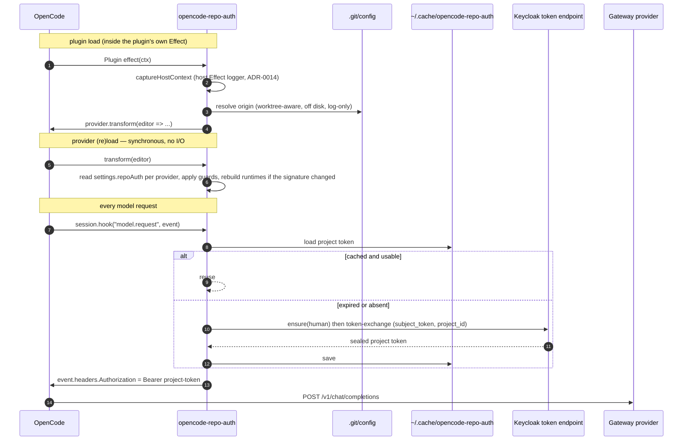
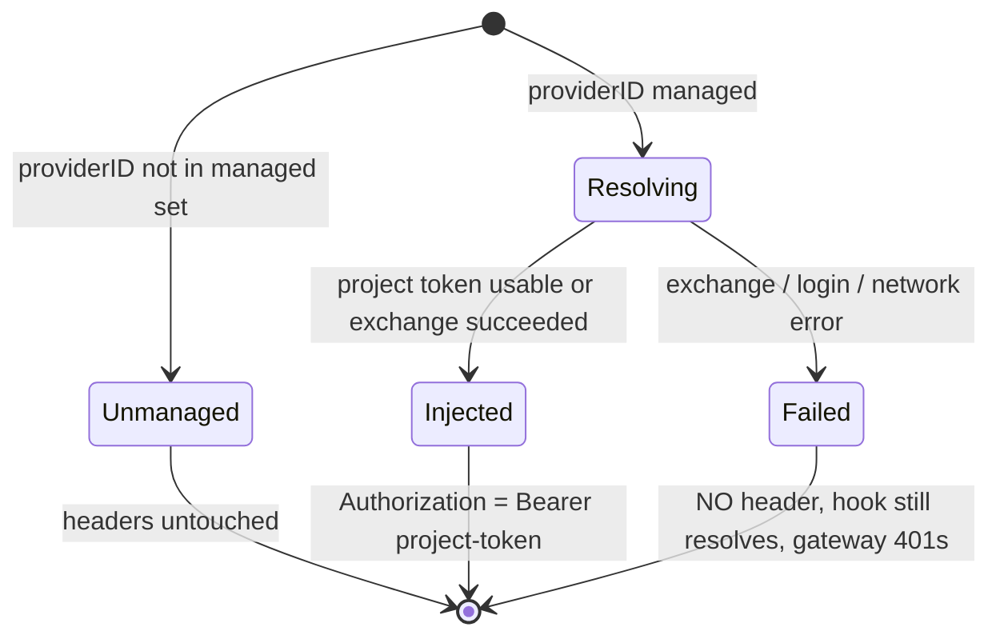
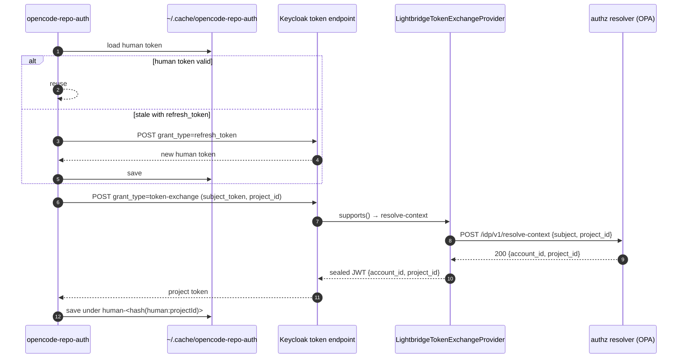

# `@vymalo/opencode-repo-auth`

> **Requires OpenCode v2.** This page describes the v2 plugin (`0.18.0`+). `0.17.x` was the last v1 release; see [Migrating from v1](#migrating-from-v1) and [ADR-0019](adr/0019-opencode-v2-cutover.md).

Status: **implemented** (issue [#67](https://github.com/ADORSYS-GIS/lightbridge-opencode-toolbeit/issues/67)) — see [ADR-0011](adr/0011-repo-auth-project-id-token-exchange.md) (Accepted) and `packages/opencode-repo-auth/`.

Goal, in one line: **give local-dev OpenCode requests the repo-as-principal attribution CI already has** — a developer authenticates once as themselves, and every gateway request from an *enrolled* repo carries a project-scoped bearer, so Authorino bills and access-controls the request to the repo's project instead of the developer's person.

This is the client half of epic [#64](https://github.com/ADORSYS-GIS/lightbridge-opencode-toolbeit/issues/64). It builds on `@vymalo/opencode-auth-core` (extracted in [#66](https://github.com/ADORSYS-GIS/lightbridge-opencode-toolbeit/pull/97)) and reuses its security-critical OAuth machinery — **no forked token code**.

## What this plugin does

On an enrolled repo (one whose config declares a `projectId` in a provider's `settings.repoAuth`), the plugin:

1. **Resolves the repo's git identity** — worktree-aware, credentials stripped — for logging and repo correlation (v1 derives nothing from it; see [Out of scope / deferred](#out-of-scope--deferred)).
2. **Ensures the developer's human token** via `auth-core`'s `TokenRuntime` (`device_code` / `authorization_code`, `offline_access`), cached per human.
3. **Exchanges it once per project** — a single RFC 8693 token exchange presenting `project_id` as a form param — and caches the SPI-sealed project token per project (`human-<hash(human:projectId)>.json`, OS cache dir, `0o600`, atomic rename, NTFS-safe key).
4. **Injects `Authorization: Bearer <project-token>`** on the *gateway provider only* (guarded by managed provider id), per request, from the `model.request` session hook.

It **no-ops** (never crashes, never touches other providers) when: the repo has no `origin` remote, the provider has no `settings.repoAuth` block, the block has no `projectId`, or the provider is already managed by `@vymalo/opencode-oauth2`.

## The contract it implements — and why the ticket body is superseded

The ticket body describes the original design: resolve git `origin` → Source id → exchange the human token to `aud = <base>/sources/src-XXX`. **That design is dead.** Two comments on [#67](https://github.com/ADORSYS-GIS/lightbridge-opencode-toolbeit/issues/67) reframed it, and the IdP side has since shipped the final shape:

| Revision | Flow | Status |
| --- | --- | --- |
| Ticket body | git remote → Source id → exchange to `aud=/sources/src-XXX` | **Superseded** |
| Comment 1 (2026-07-07) | mint `request_id` via authz `POST /api/v1/idp/requests` → exchange with `request_id` | **Superseded** (SPI simplified) |
| Comment 2 (2026-07-07) — **authoritative** | **single Keycloak token exchange** presenting `project_id` form param; SPI seals `{account_id, project_id}` | **Live** — confirmed by [`lightbridge-keycloak-spi` architecture](https://github.com/ADORSYS-GIS/lightbridge-keycloak-spi/blob/main/docs/architecture.md) |

Consequences for the plugin:

- **No `aud=Source`, no mint step, no client-side resolve call.** The `project_id` is **declared** in `opencode.json` (`settings.repoAuth.projectId`) — a repo may belong to many projects, so it is never derived from the remote. The SPI's backend resolver (`lightbridge-authz` `POST /idp/v1/resolve-context`) does the membership check server-side.
- **Cache is keyed by `project_id`** (hashed), not by Source.
- The ticket's "resolve-by-remote" stays deferred (see [Out of scope / deferred](#out-of-scope--deferred)); the git module in v1 exists for repo identity/logging and worktree correctness.

## The exchange contract (from `lightbridge-keycloak-spi`)

The plugin must produce exactly this request at the Keycloak token endpoint:

```
POST <tokenEndpoint>
Content-Type: application/x-www-form-urlencoded

grant_type=urn:ietf:params:oauth:grant-type:token-exchange
client_id=opencode-cli
subject_token=<human JWT>
subject_token_type=urn:ietf:params:oauth:token-type:jwt
project_id=<declared project id>
```

- **No `audience` param.** The SPI rejects a self-audience ("Requested audience not available") — this is why `auth-core`'s existing `exchangeToAudience` cannot be used as-is (see [The auth-core gap](#the-auth-core-gap--key-decision)).
- The SPI (`LightbridgeTokenExchangeProvider`, order 100) claims the request when `project_id` is present, calls the authz resolver with `{subject, project_id}`, and on success returns a JWT sealed with `{account_id, project_id}` claims (`aud` = the requesting client). On **non-membership / unknown project / resolver error it fails closed — no token**.
- Without `project_id`, Keycloak's built-in `StandardTokenExchangeProvider` handles the exchange unchanged — the plugin never sends a bare exchange.

## Plugin behavior

Two registrations on the v2 plugin context (`Plugin.define({ id: "vymalo.repo-auth", effect })`,
[`opencode.ts`](../packages/opencode-repo-auth/src/opencode.ts)):



### Provider transform (`ctx.provider.transform`) — replaces the v1 `config` hook

Runs on every provider load/reload. It must stay **synchronous and cheap**, so it does no I/O and mints no token:

1. **Walk `editor.list()`**; a provider opts in via **`settings.repoAuth`**. Parse + validate the block (see [Config shape](#config-shape)). Providers without it are skipped (`repo_auth_provider_skipped`).
2. **oauth2-conflict guard** (see below): a provider that looks oauth2-managed is skipped with `repo_auth_skipped_oauth2_provider` (warn).
3. **Single-IdP guard:** two opted-in providers must resolve to the same IdP (they share one human root file); the first IdP group wins, the rest are skipped with `repo_auth_multiple_idps_unsupported`.
4. **Build the runtimes** over `auth-core`: one `TokenRuntime` keyed by the human identity, `cacheDir = <cacheRoot>/opencode-repo-auth`. They are rebuilt only when the managed-set signature changes (`repo_auth_runtime_rebuild` / `repo_auth_runtime_reused`).

The git identity is resolved **once at plugin load** (not per transform): `repo_auth_remote_resolved` or `repo_auth_remote_missing`. Log-only, as before.

#### The oauth2-collision guard, re-derived from the provider editor

v1 detected a provider "also managed by oauth2" from the config object, via two channels: the provider's own `options.oauth2` / `options.oauth2ModelSync` blocks, and the `pluginConfig.oauth2ModelSync.servers` id list. v2 has neither `options` nor `pluginConfig`, and another plugin's `ctx.options` is private to it. What the provider editor does expose is the `ProviderRecord`, so the guard now reads:

| Signal on the provider record | Replaces |
| --- | --- |
| `settings.oauth2` / `settings.oauth2ModelSync` present | v1 `options.oauth2` / `options.oauth2ModelSync` |
| `integrationID` set (the provider is owned by a v2 Integration, which supplies its own credentials) | new in v2 — the structural marker of an OAuth-managed provider |

**Known gap:** the `pluginConfig.oauth2ModelSync.servers` channel cannot be re-derived. The guard is therefore only as complete as the markers oauth2's v2 port puts on the providers it registers; until it sets `integrationID` or `settings.oauth2`, a provider registered that way is not recognised as oauth2-owned. Don't enable both plugins on one provider.

### Per-request (`ctx.session.hook("model.request")`) — replaces `chat.headers`

1. Take the provider id from `event.model.providerID`.
2. **Managed-provider guard:** not a `settings.repoAuth` provider → return untouched (`event.headers` is not modified).
3. `ensure(human)` (interactive allowed here — the first request may trigger the device-code/browser flow).
4. Read the cached project token for `projectId` (`human-<hash(human:projectId)>.json`):
   - valid → inject;
   - expired / absent → **re-exchange from the offline root** ("model b") → cache → inject.
5. **Fail closed:** an exchange failure (non-member, resolver error, network, no human login) produces **no header** — the hook resolves normally and the gateway 401s, which is the correct behavior (matches the SPI's fail-closed semantics). Emits `repo_auth_exchange_failed` at error. Host-level caveat: if the provider also has a static credential configured, OpenCode itself sends that as `Authorization` when our hook injects nothing — a bogus credential the gateway still refuses, so the posture stays fail-closed; on success the project bearer overwrites it.



The project token is **never refreshed** — exchanged tokens carry no refresh token and re-exchange is the canonical renewal (epic risk mitigation: "Exchange `aud` not preserved across refresh → default to re-exchange from the offline root"). The human root token *is* refreshed via its `offline_access` refresh token.

### What v2 dropped: the config-time bearer stamp

v1 also warmed the exchange at config time and stamped `Authorization` onto `provider.options.headers`, so `@vymalo/opencode-models-info` could fetch an OAuth2-protected `meta.modelsInfoUrl`. That is gone, deliberately:

- a `provider.transform` callback is synchronous — it cannot await a token exchange; and
- a header stamped onto the provider would **survive a failed exchange as a stale bearer**, which contradicts fail-closed. The per-request hook is now the only place a credential is ever written.

Consequence: nothing is exchanged at plugin load; the first model request pays the exchange. An OAuth2-protected metadata endpoint can no longer inherit repo-auth's bearer — that handshake belongs to the `models-info` v2 port.

### No-op matrix

| Condition | Behavior |
| --- | --- |
| No `origin` remote / not a git repo | `repo_auth_remote_missing`; plugin still works if `projectId` is declared (remote is log-only) |
| Provider without `settings.repoAuth` | skipped, untouched |
| `settings.repoAuth` without `projectId` | `repo_auth_skipped_no_project_id` (warn); no crash |
| Provider carries `settings.oauth2` / `settings.oauth2ModelSync`, or has an `integrationID` | `repo_auth_skipped_oauth2_provider` (warn); skipped |
| No human login yet | nothing happens at load; the first `model.request` runs the device-code login |
| Exchange fails (non-member / resolver error) | no header; `repo_auth_exchange_failed`; gateway 401s (fail closed) |

## Concrete walkthrough (Alice, `acme/webapp`, `proj-123`)

The flow is two-phase — **boot** (plugin load + provider transform) and **per request** (`model.request`) — and involves **two tokens**. This section walks one concrete example end to end.

### The cast

| Thing | Value | Notes |
| --- | --- | --- |
| Developer | Alice | logs in once as herself |
| Repo | `acme/webapp` (checked out at `/home/alice/work/acme-webapp`, a linked worktree) | |
| Project | `proj-123` | declared in `opencode.json`, never derived |
| IdP | `https://idp.acme.com/realms/camer-digital` (Keycloak) | |
| Gateway | `https://gateway.acme.com/v1` | the only provider repo-auth manages |
| **Human token** | `eyJ…` (JWT) + refresh token | "who Alice is" — cached at `~/.cache/opencode-repo-auth/human.json` |
| **Project token** | `eyJ…` (JWT with `account_id` + `project_id` claims) | "Alice working on proj-123" — cached at `~/.cache/opencode-repo-auth/human:<hash>.json` |

`opencode.json` (the enrolled-repo config):

```jsonc
{
  "plugins": ["@vymalo/opencode-repo-auth"],
  "providers": {
    "gateway": {
      "package": "aisdk:@ai-sdk/openai-compatible",
      "settings": {
        "baseURL": "https://gateway.acme.com/v1",
        "repoAuth": {
          "projectId": "proj-123",
          "issuer": "https://idp.acme.com/realms/camer-digital",
          "clientId": "opencode-cli",
          "scopes": ["openid", "offline_access"],
          "authFlow": "device_code",
          "tokenEndpoint": "https://idp.acme.com/realms/camer-digital/protocol/openid-connect/token",
          "deviceAuthorizationEndpoint": "https://idp.acme.com/realms/camer-digital/protocol/openid-connect/auth/device"
        }
      }
    }
  }
}
```

### Boot — what happens when opencode starts

1. opencode starts in the repo and loads plugins. repo-auth's plugin Effect runs and captures the host's Effect context so its diagnostics reach the host log, never the terminal.
2. **Git identity (log-only):** the plugin reads `.git/config` (worktree-aware — `.git` is a *file* here pointing at the common dir) and finds `origin = git@github.com:acme/webapp.git`, normalizes it to `github.com/acme/webapp` (userinfo stripped, scp form normalized), logs `repo_auth_remote_resolved`. Nothing is derived from it in v1.
3. **Provider transform:** the plugin finds `gateway` carries `settings.repoAuth` → parses it → `projectId = "proj-123"` + the auth config. This is the only provider it will ever touch.
4. **Runtime:** one `TokenRuntime` (auth-core) keyed by the human identity, cache dir `~/.cache/opencode-repo-auth/`.
5. Boot is done. **No token was read, refreshed or exchanged, and nothing was sent anywhere.** (v1 warmed the exchange here; see [What v2 dropped](#what-v2-dropped-the-config-time-bearer-stamp).)

### A chat request — what happens when Alice sends a message

1. Alice types a message; opencode resolves the model to provider `gateway` and fires the `model.request` session hook.
2. **Guard:** `gateway` is a managed provider (carries `settings.repoAuth`) → proceed. Any other provider → return untouched.
3. **Human token** (`ensure(human)`, interactive allowed): if Alice never logged in, this is where the device-code flow runs — auth-core prints a `[opencode-repo-auth] device-code login for …` block to the terminal with the verification URL and code (the one deliberate exception to the plugin's otherwise-silent terminal, [ADR-0014](adr/0014-suite-wide-no-terminal-mirror.md) — every other diagnostic goes only to OpenCode's own log), Alice completes it in her browser, the plugin polls and stores the human token + refresh token. If she has one, it's reused/refreshed silently. A first-time refresh is one `POST grant_type=refresh_token`.
4. **Project token:** read `<cacheDir>/human-<hash(human:proj-123)>.json`:
   - still valid → use it;
   - expired or absent → one POST to the token endpoint (no user interaction — the human refresh token makes it automatic) → save → use it:

     ```
     POST https://idp.acme.com/realms/camer-digital/protocol/openid-connect/token
     Content-Type: application/x-www-form-urlencoded

     grant_type=urn:ietf:params:oauth:grant-type:token-exchange
     client_id=opencode-cli
     subject_token=eyJ…            ← Alice's human token
     subject_token_type=urn:ietf:params:oauth:token-type:jwt
     project_id=proj-123
     ```

     Keycloak's SPI checks Alice's membership of `proj-123` via the authz resolver; on success it returns a JWT sealed with `{account_id: "acc-42", project_id: "proj-123"}`. The plugin saves it under `human-<hash(human:proj-123)>.json`.
5. **Inject:** `event.headers.Authorization = "Bearer <project token>"`.
6. opencode sends `POST https://gateway.acme.com/v1/chat/completions` with that header. Authorino validates the JWT, reads `account_id`/`project_id`, and bills the request to the project.

### The token timeline (why two tokens, what "model b" means)

- The **human token** only says "Alice". It is never sent to the gateway.
- The **project token** says "Alice working on proj-123" — that is what the gateway/Authorino accepts and bills. It is short-lived (Keycloak exchange tokens are typically minutes) and has **no refresh token**.
- **"Model b"** is the renewal rule: never try to refresh the project token (a refresh would lose the project claims — the epic's "exchange `aud` not preserved across refresh" risk). Instead, when it expires, re-do the exchange from the **offline root** — the human token, which *does* have a refresh token and can renew itself without any user interaction. So after the one-time login, every subsequent renewal is automatic: human refresh (1 POST) → re-exchange (1 POST) → inject.

```
login (once, interactive) → human token + refresh token
        │
        ▼
exchange (per project, on demand) → project token {account_id, project_id}
        │
        ▼
chat request → inject project token on the gateway provider only
        │
        └─ project token expired? → re-exchange from the human token (automatic)
```

### Human token vs project token

| | **Human token** | **Project token** |
| --- | --- | --- |
| **What it says** | "Alice is logged in" | "Alice is logged in **and is working on project `proj-123`**" |
| **Claims it carries** | `sub` (Alice's user id), `iss`, `aud = opencode-cli`, scopes | `sub` + **`account_id`** + **`project_id`** (sealed by the SPI) |
| **Who issues it** | Keycloak directly, when Alice completes the device-code login | Keycloak's **SPI**, during the token exchange (human token + `project_id` → membership check → sealed JWT) |
| **How it's obtained** | One-time interactive login (device code in the terminal) | On demand, automatically — one POST, no user interaction |
| **Renewal** | Has a **refresh token** (`offline_access` scope) → renews itself silently | **No refresh token** → when it expires, re-do the exchange ("model b") |
| **Lifetime** | Longer (Keycloak access token, refreshable) | Short (typically minutes) |
| **Who consumes it** | Only the plugin itself — as the `subject_token` in the exchange | The **gateway** — as `Authorization: Bearer` on every chat request |
| **Where it's cached** | `~/.cache/opencode-repo-auth/human.json` | `~/.cache/opencode-repo-auth/human-<hash>("human:<proj-123>").json` (identity-prefixed `-`, hashed over the `identity:key` pair — no `:` in filenames, so the layout is NTFS-safe; separate human identities can never collide on the same project key) |
| **If it leaks** | Attacker can impersonate Alice — exchange it for project tokens of **any** project she belongs to. This is the master credential. | Attacker can make gateway requests billed to **one project**, for a few minutes, until it expires. Bounded blast radius. |

> **If a project token was revoked but its cached copy hasn't expired yet**, the gateway will keep returning `401` until the TTL elapses — the exchange only re-runs on expiry, and the plugin does not observe 401s (it registers no response hook). The project token is bound to a short TTL by design, so this self-heals within minutes. To force it now, delete the cached file (`<cacheDir>/human-<hash>.json`) — the next request re-exchanges from the human root. `repo-auth reset` (see [Caching and reset](#caching-and-reset)) clears the human root and every exchanged token at once.

The human token is the **offline root** (the thing that can renew itself); the project token is the **leaf credential** (what actually touches the gateway). The gateway never sees the human token; the human token never carries project context.

### Failure modes, concretely

- Alice is **not a member** of `proj-123` (or the project doesn't exist): the SPI returns 404, the exchange fails, the plugin injects **no header**, and the gateway 401s. Fail closed — the request never runs under a wrong identity.
- The gateway provider is also managed by `@vymalo/opencode-oauth2` (see [the collision guard](#the-oauth2-collision-guard-re-derived-from-the-provider-editor)): the plugin skips it with `repo_auth_skipped_oauth2_provider` — the two plugins never fight over one provider.
- No `projectId` in the `repoAuth` block: the provider is skipped, nothing crashes.

## Architecture

### Package layout

Mirrors the per-package convention (see `AGENTS.md`), **minus `cache.ts`** (auth-core's `FileCacheStore` via `TokenRuntime` owns persistence) and **plus `git.ts`**:

```
packages/opencode-repo-auth/
├── src/
│   ├── index.ts        # slim entry — single `export { default } from "./opencode.js"`
│   ├── opencode.ts     # v2 plugin factory: createOpencodeRepoAuthPlugin(opts) → Plugin.Plugin; provider.transform + model.request
│   ├── plugin.ts       # RepoAuthPlugin runtime — testable core (ensure/exchange/inject)
│   ├── config.ts       # settings.repoAuth parsing + validation → AuthServerConfigInput + projectId; oauth2-collision predicate
│   ├── logging.ts      # captureHostContext + createEffectLogger (host Effect logger, ADR-0014)
│   ├── git.ts          # worktree-aware repo-root + origin-remote resolution, remote normalization
│   └── lib.ts          # public API (embedders): createOpencodeRepoAuthPlugin, RepoAuthPlugin, git utils
└── test/               # vitest, *.test.ts
```

- **No `cache.ts`** — token persistence is auth-core's `FileCacheStore` (atomic rename, `0o600`, ADR-0005), reached through `TokenRuntime`. The plugin keeps only in-memory runtime state (managed provider ids, runtime signature).
- **Logging.** The `Logger` interface and level ordering come from `auth-core`; the *sink* is this package's `logging.ts`, which writes through the host's Effect logger ([ADR-0014](adr/0014-suite-wide-no-terminal-mirror.md), [ADR-0019](adr/0019-opencode-v2-cutover.md)). `effect` is a **peer** dependency so the host's copy — and therefore its logger — is the one in use.
- **`git.ts` reads off disk** (`.git/config`, worktree-aware) rather than shelling out to `git` — the house precedent set by otel's VCS collector (CHANGELOG 0.14.0: read `.git/config`/`HEAD`/`refs` directly; no subprocess, no `git` on `PATH`). For a linked worktree `.git` is a *file* containing `gitdir:` — resolve the common dir, then read `[remote "origin"] url` from the common dir's config. `normalizeRemote` strips `user:pass@` userinfo, normalizes scp-style (`git@host:org/repo.git`) and https forms, drops query/fragment. Trade-off accepted: raw config misses `url.<base>.insteadOf` rewrites that `git remote get-url` would apply — irrelevant in v1 because the remote is log-only; revisit if resolve-by-remote lands.

### Config shape

Per-provider opt-in via **`settings.repoAuth`** (v1: `options.meta.repoAuth`; `Provider.Info` has no `options` in v2, but `settings` is an open struct). The auth-server fields ride in the same block so each managed provider is self-contained:

```jsonc
{
  "plugins": ["@vymalo/opencode-repo-auth"],
  "providers": {
    "gateway": {
      "package": "aisdk:@ai-sdk/openai-compatible",
      "settings": {
        "baseURL": "https://gateway.example.com/v1",
        "repoAuth": {
          "projectId": "proj-123",
          "issuer": "https://idp.example.com/realms/camer-digital",
          "clientId": "opencode-cli",
          "scopes": ["openid", "offline_access"],
          "authFlow": "device_code",
          "tokenEndpoint": "https://idp.example.com/realms/camer-digital/protocol/openid-connect/token",
          "deviceAuthorizationEndpoint": "https://idp.example.com/realms/camer-digital/protocol/openid-connect/auth/device"
        }
      }
    }
  }
}
```

Plugin-level options (v1: `pluginConfig`) go on the plugin entry; the only one is `logLevel` (`"TRACE"|"DEBUG"|"INFO"|"WARN"|"ERROR"`), falling back to `OPENCODE_LOG_LEVEL`.

- `projectId` is required; everything else maps onto `AuthServerConfigInput` (auth-core) — explicit endpoints optional, OIDC discovery fills the gaps (auth-core's `resolveEndpoints`).
- `authFlow` defaults to `authorization_code` (auth-core's `DEFAULT_AUTH_FLOW`); `device_code` is the recommended interactive flow for a CLI.
- `scopes` must include `offline_access` so the human root gets a refresh token (the "offline root" that model-b re-exchange depends on).
- Alternative considered: a shared plugin-level `options.repoAuth` for the IdP config with only `projectId` per provider. Rejected for v1 — the ticket's stated shape is per-provider, the suite's opt-in convention is per-provider (`settings.<key>`), and the "one gateway provider" case is the norm. Revisit only if multi-provider duplication becomes real.

### Runtime composition over auth-core

- **One `TokenRuntime` per distinct `AuthServerConfig`** (v1: one — a single Keycloak realm). The runtime is identity-keyed; the identity is the **human** (`"human"` constant — the plugin is single-IdP in v1; if multi-IdP ever lands, derive `issuer|clientId`).
- **Human root token**: `ensure()` / `refresh()` — cached at `<cacheDir>/human.json`.
- **Project token**: `exchangeTo(projectId, subjectToken, { project_id })` — cached at `<cacheDir>/human-<hash("human:"+projectId)>.json`.
- **Key derivation** is `auth-core`'s `exchangeCacheKey` — `${identity}-${hashCacheKey(`${identity}:${key}`)}`: a deterministic truncated `sha256` hex of the **`identity:key` pair** (the `/`-separator was replaced by `-` and the full pair is hashed, so the filename is NTFS-safe — no `:` — and two identities exchanging for the same project can never collide). It is a cache-key derivation from an upstream id, not a minted record id — the CUID2 rule does not apply. `FileCacheStore` uses keys verbatim as filenames ([`cache.ts:36`](../packages/opencode-auth-core/src/cache.ts)).
- **Reset / log-out** (`repo_auth_reset`): removes `human.json` **and** every `human-*` exchanged token — `TokenRuntime.reset` now walks the cache dir via `listKeys(`${identity}-`)` and deletes each ([`token-runtime.ts`](../packages/opencode-auth-core/src/token-runtime.ts)). A bad day can be undone with `rm -rf <cacheDir>`, but the API no longer leaves orphaned project tokens behind a cleared human root.
- **`cacheDir`**: `join(resolveCacheRoot(), "opencode-repo-auth")` — the ticket's namespace, and the pattern `resolveCacheRoot` exists for (oauth2 keeps `<root>/opencode-oauth2`; auth-core's default `opencode-auth-core/` is not used here).

### The auth-core gap (key decision)

`auth-core`'s only exchange primitive is `exchangeToAudience(audience, subjectToken)` ([`token-runtime.ts:87`](../packages/opencode-auth-core/src/token-runtime.ts)), which POSTs an `audience` form param — **exactly what the SPI rejects**. The plugin needs a `project_id` form param. Options:

| Option | Description | Verdict |
| --- | --- | --- |
| **A — extend auth-core (recommended)** | Generalize the federated-grant machinery: `OAuthClient.exchange({ subjectToken, extraParams })` + `TokenRuntime.exchangeTo(key, subjectToken, extraParams)`, cached under an identity-prefixed hash of the `identity:key` pair (`identity-<hash(identity:key)>`, NTFS-safe). `exchangeToAudience` stays a compatibility wrapper (`exchangeTo(audience, subjectToken, { audience })`). repo-auth calls `exchangeTo(projectId, humanToken, { project_id: projectId })`. | **Adopt.** Keeps the security-critical code (timeout, scrubbing, redaction, PKCE-free machine grant) in the one place #66 exists to create. Generic, not SPI-shaped — auth-core stays model-free. |
| B — plugin does its own HTTP POST | Duplicate the token-endpoint call in repo-auth. | **Reject.** Re-creates the exact drift #66 was filed to eliminate (timeout/scrub/redact bugs land in two places). |
| C — pass `projectId` as `audience` | No auth-core change. | **Reject.** The SPI explicitly rejects a self-audience; the exchange would fail closed every time. |

The extension is small and backward-compatible; it can ride in the repo-auth PR (auth-core is still under review in #97) or land as a tiny auth-core PR first — one PR per concern suggests the latter if #97 merges first.

> **Review note for #97 (resolved in the review round):** `TokenRuntime.exchangeToAudience` caches under a derived key and `FileCacheStore` uses keys verbatim as filenames — a URL-shaped key (`https://…/sources/src-1`) would be path-unsafe on Windows (`:`) and would create nested dirs on POSIX (`/`). The generic `exchangeTo` now derives its key as `identity-<hash(identity:key)>` ([`token-runtime.ts`](../packages/opencode-auth-core/src/token-runtime.ts) `exchangeCacheKey`), which eliminates both classes of problem for every caller, repo-auth included.

### Token lifecycle ("model b")

```
project token valid? ──yes──▶ inject cached
        │ no (expired / absent / no expires_in)
        ▼
ensure(human)   ← refreshes the offline root via its refresh_token if stale
        ▼
exchangeTo(projectId, humanToken, { project_id })
        ▼
cache + inject
```

- The project token's `expiresAt` comes from the exchange response's `expires_in`. **Undefined expiry → treat as expired** (re-exchange each time) — matching auth-core's machine-flow policy ([`client.ts:76`](../packages/opencode-auth-core/src/oauth/client.ts)) and the ticket's "short TTL" intent.
- Validity check applies the standard `tokenExpirySkewMs` (default 30s) headroom.
- No scheduler: the project token is only consumed when a request runs; proactive re-exchange gains nothing and costs a round trip. Lazy re-exchange on `model.request` is the whole lifecycle.

### Events (snake_case, house pattern)

| Event | When | Level |
| --- | --- | --- |
| `repo_auth_plugin_start` / `repo_auth_transform_finished` | plugin load / provider transform exit | trace |
| `repo_auth_remote_resolved` / `repo_auth_remote_missing` | git identity resolution | debug / trace |
| `repo_auth_provider_opted_in` / `repo_auth_provider_skipped` | provider walk | trace |
| `repo_auth_skipped_no_project_id` | `repoAuth` block without `projectId` | warn |
| `repo_auth_skipped_malformed` | unparseable `settings.repoAuth` (other providers still managed) | warn |
| `repo_auth_skipped_oauth2_provider` | oauth2-conflict guard | warn |
| `repo_auth_skipped_invalid_auth` | `RepoAuthPlugin` construction failed (invalid auth config) | warn |
| `repo_auth_human_token_ensured` | `ensure(human)` result | debug |
| `repo_auth_exchange_started` / `_success` / `_failed` | token exchange | info / info / error |
| `repo_auth_exchange_cache_hit` / `_miss` | project-token cache read | trace |
| `repo_auth_model_request_bearer_injected` / `repo_auth_model_request_skipped` / `repo_auth_model_request_no_bearer` | per-request injection / unmanaged provider / exchange failure degraded to no header | trace |

Happy-path lifecycle events sit at `debug`/`trace` (silent at default `info`), failures at `warn`/`error` — same convention as oauth2.

### Sequence

The v2 interaction and lifecycle diagrams are under [Plugin behavior](#plugin-behavior). The exchange itself, on a cache miss:



## Security posture

- **Managed-provider guard** — the project bearer is only ever injected on providers carrying `settings.repoAuth`. No repo/project identity leaks to other providers (the ticket's "leaking repo URL to non-gateway providers" risk).
- **oauth2-conflict guard** — never both plugins on one provider; skip + warn, never crash.
- **Redaction** — auth-core's logger redacts `token|secret|password` fields; `scrubSecrets` masks token-shaped substrings in error bodies; `redactUrl` strips userinfo/query from logged endpoints. The normalized remote has userinfo stripped before it is ever logged.
- **Disk** — `0o600` files, atomic rename, `0o700` dirs (auth-core `FileCacheStore`, ADR-0005).
- **Fail closed** — exchange failure ⇒ no header ⇒ gateway 401. The plugin never invents a token, and (since v2) never writes a credential anywhere but the per-request `event.headers`, so there is no stale stamp to outlive a failed exchange.
- **No content capture** — the plugin only reads/writes headers and the token cache; it never sees prompts or responses.

## Composition contract

- **Ordering in `plugins`:** repo-auth only writes request headers per request, so it no longer needs to precede `models-info` for a config-time handshake (that handshake was dropped in v2). Order is otherwise cosmetic.
- **Never on the same provider as `@vymalo/opencode-oauth2`** — documented + guarded (see [No-op matrix](#no-op-matrix)). A dev may run both plugins on *different* providers (oauth2 for one IdP, repo-auth for the gateway); they share nothing — separate cache namespaces, separate runtimes.
- **"After any user-bearer"** (ticket wording) is interpreted as: on a managed provider, the project bearer **wins** per request (it is the more specific credential and the gateway requires it). v1's "a user-set `Authorization` wins at config time" rule went away with the config-time stamp.

## Testing

- **Unit** (`test/*.test.ts`, vitest):
  - `git.ts`: scp vs https normalization, `user:pass@` stripping, query/fragment drop, linked-worktree `.git` file resolution, missing remote.
  - `config.ts`: `settings.repoAuth` parsing, missing `projectId`, oauth2-conflict detection (`settings.oauth2*`, `integrationID`), `AuthServerConfigInput` mapping.
  - `opencode.ts`: a fake v2 `Plugin.Context` drives `provider.transform` and `model.request`; fail-closed on exchange error / network error / cold cache; managed-provider-only injection; IdP guard; runtime reuse; no I/O in the transform.
  - `logging.ts` (**ADR-0014 regression**): a recording `Logger.make` installed with `Logger.layer(..., { mergeWithExisting: false })` and captured through the production `captureHostContext`; asserts severity + annotations at the host sink and that `console.*` is never called by default.
  - `plugin.ts`: cache keying (`identity-<hash(identity:key)>` deterministic, NTFS-safe), exchange request shape (asserts `project_id` form param present, no `audience`), model-b re-exchange on expiry, in-flight exchange dedup, no-op matrix, reset clears human + project tokens, fail-closed on exchange error.
- **Integration** (`test/integration/exchange.integration.test.ts`, WireMock via the [`test-env`](../test-env/) compose stack, self-skips unless `INTEGRATION_REPO_AUTH_TOKEN_URL` is set): real-HTTP exchange of a seeded human root (asserts via WireMock's request journal that the POST carries `grant_type=token-exchange` + `subject_token` + `project_id` and **no** `audience`), `model.request` injection of the sealed bearer (and no exchange at load), cache-hit without a second exchange, stale-bearer re-exchange, and non-member → 403 → fail-closed no header.
- **Manual e2e** against the real gateway: enrolled repo + logged-in dev → gateway sees the project bearer; unenrolled repo → no header. A scripted variant against the test-env stack (real `opencode` binary, WireMock as IdP + gateway) is in [`docs/local-development.md`](local-development.md#repo-auth-end-to-end-against-the-test-env-stack).

## Out of scope / deferred

- **resolve-by-remote** (derive `projectId` from the remote) — deferred; the git module is built to support it later.
- **Monorepo sub-project Sources** — one project per repo in v1.
- **Self-serve Source claiming** — stays operator-controlled (ADR-0049).
- **`auth-core` extraction** — done in #66 (PR #97).
- **`opencode-core` kit** unifying logging/cache/config across all plugins — separate refactor.

## Decisions to confirm + ADR candidates

1. **`project_id` form-param exchange vs the ticket body's `aud=Source`** — the design follows the superseding comments + the live SPI contract. Worth an ADR (the ticket references `docs/adr/0005-…`; this decision closes off the audience-scoped design someone would reasonably reach for).
2. **auth-core generic exchange extension** (Option A) — small, backward-compatible; confirm whether it rides in the repo-auth PR or lands as a separate auth-core PR.
3. **Read-off-disk git vs `git` CLI** — off-disk matches otel's precedent; CLI would honor `insteadOf` rewrites. Log-only in v1, so off-disk wins.
4. **"After any user-bearer" interpretation** — project bearer wins per request on managed providers.
5. **Config shape** — per-provider `settings.repoAuth` (recommended) vs a shared plugin-level `options.repoAuth`.

## Migrating from v1

`0.18.0` targets the OpenCode **v2** plugin API; `0.17.x` was the last v1 release. See
[ADR-0019](adr/0019-opencode-v2-cutover.md) for why there is no dual-support build.

| v1 | v2 |
| --- | --- |
| `"plugin": [...]` | `"plugins": [...]` |
| `"provider": { ... }` | `"providers": { ... }` |
| `"npm": "@ai-sdk/openai-compatible"` | `"package": "aisdk:@ai-sdk/openai-compatible"` |
| `options.baseURL` | `settings.baseURL` |
| `options.meta.repoAuth` | `settings.repoAuth` |
| `pluginConfig.repoAuth.logLevel` / host `config.logLevel` | the plugin's own `options.logLevel`, else `OPENCODE_LOG_LEVEL` |
| `config` hook (provider walk) | `ctx.provider.transform` |
| `chat.headers` hook | `ctx.session.hook("model.request")` (`event.headers`, `event.model.providerID`) |
| config-time warmup + `options.headers.Authorization` stamp | **removed** — the first request exchanges; nothing is stamped |
| oauth2 guard: `options.oauth2*` or `pluginConfig…servers` ids | `settings.oauth2*` or `integrationID` on the provider record |
| `client.app.log` | the host's Effect logger via `captureHostContext` |
| peer deps: none | `effect` `^4.0.0` (peer) |

The `repoAuth` block's own fields (`projectId`, `issuer`, `clientId`, `scopes`, `authFlow`, endpoints, `pkce`,
`clientSecret`, `subjectTokenSource`) are unchanged, as are the exchange wire contract, the cache layout
(`~/.cache/opencode-repo-auth`, so an existing login survives the upgrade), and every surviving `repo_auth_*`
event name. Renamed: `repo_auth_config_hook_*` → `repo_auth_plugin_start` / `repo_auth_transform_finished`,
`repo_auth_chat_headers_*` → `repo_auth_model_request_*`. Removed: `repo_auth_bearer_propagat*`.
